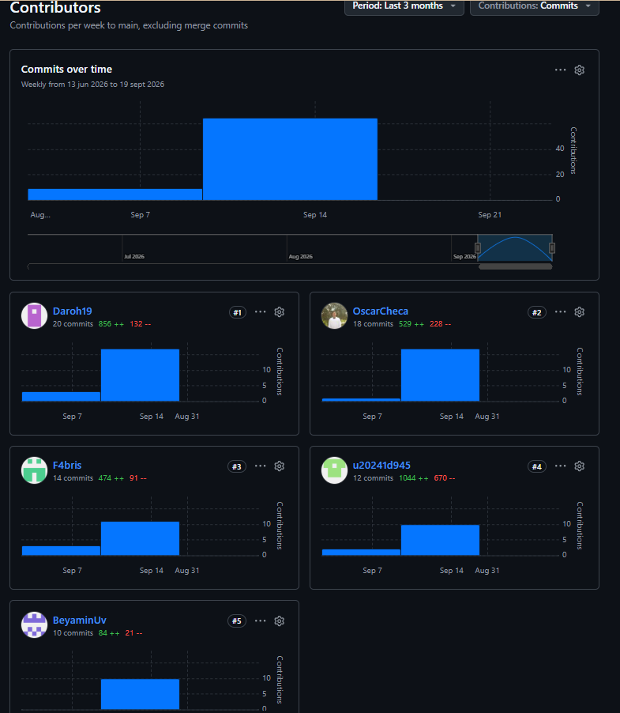

# PROYECT REPORT COLLABORATION INSIGHTS

El reposito publico de nuestro informe se encuentra organizado bajo la organizacion del equipo en GitHub, siguiendo la nomenclatura fijada en el enunciado del trabajo final. El informe fue redactado en formato **Markdown**.

Repositorio del Informe:

El repositorio aplica **GitFlow** para el control de  las versiones y **Convetional Commits** para los mensajes.

----

# AVI - Sprint Review (Semana 4)

Durante la elaboracion de la entrega AV1, el equipo se organizo asignado las secciones especificas del informe. Se realizaron sesiones de retroalimentacion para la coordinacion de la elaboracion del reporte.

| Integrantes | Actividades realizadas en el informe |
|-------------|--------------------------------------|
| **Tello Palacios, Fabrizio Rafael** | Diseño de prototipos mobile y desktop. Diseño de user flow diagrams y wireflows. Edicion de estructura del proyecto |
| **Checa Burga, Oscar Diego** | Desarrollo el Capitulo 1 del informe, ademas realizo el diseño de la landing page y web/mobile apps tanto mockups como wireframes. |
| **Yanac Flores, Gabriel Stefano** | Diseño de entrevista, definicion de epicas y user stories, impact map, product backlog y documentacion del design level event storming. |
| **Palomino Vilcañaupa, Daril Johan** | Durante el primer avance de este entrega, desarrolle las secciones que corresponden el needfinding y el style guidelines. |
| **Urviola Condori, Mateo Sebastian** | Conseguir entrevistar del segmento 1 y 2, Registrar entrevistas de cada segmento, realizar el diagrama de Contexto c4 model, realizar el diagrama de contenedores c4 Model, realizar los diagramas de componentes c4 Model |

# TB1 - Sprint Review (Semana 7)

Durante la elaboracion de la entrega AV1, el equipo se organizo asignado las secciones especificas del informe. Se realizaron sesiones de retroalimentacion para la coordinacion de la elaboracion del reporte.

| Integrantes | Actividades realizadas en el informe |
|-------------|--------------------------------------|
| **Tello Palacios, Fabrizio Rafael** | Desarrollo las seccion del bounded context de booking de frotend. Ademas de la colaboracion en la implementacion de routes y el despliegue de del frotend mediante github pages  |
| **Checa Burga, Oscar Diego** | Desarrollo las seccion del bounded context de booking, iam, i18n de frotend. Ademas de la colaboracion en la implementacion de routes |
| **Yanac Flores, Gabriel Stefano** | Desarrollo las seccion del bounded context de notifications, rating-from y localization de frotend. Ademas de la colaboracion en la implementacion de routes y reputation |
| **Palomino Vilcañaupa, Daril Johan** | Desarrollo las seccion del bounded context de payments de frotend. |
| **Urviola Condori, Mateo Sebastian** | Desarrollo las seccion del bounded context de parking-space de frotend  |

# AV2 - Sprint Review (Semana 12)

Durante la elaboración de la entrega, el equipo se organizó asignando las secciones específicas del informe y distribuyendo los frentes de desarrollo del Sprint 3 (líderes, colaboradores y apoyo por módulo). Se realizaron sesiones de retroalimentación para la coordinación de la elaboración del reporte y la integración de los servicios y la aplicación web.

| Integrantes | Actividades realizadas en el informe y apoyo en desarrollo (Sprint 3) |
|-------------|-----------------------------------------------------------------------|
| **Tello Palacios, Fabrizio Rafael** | Diseño de prototipos mobile y desktop, user flow diagrams y wireflows, y edición de la estructura del proyecto. En el Sprint 3, lideró (L) los módulos de Espacios y Publicaciones (`US06–US10`) y Reservas e Historial (`US15–US18`), colaboró (C) en IAM y Seguridad (`US01, US02, US05`) y en Incidentes, Alertas y Despliegue, y brindó apoyo (A) en Pagos, Reputación y Analytics (`US22–US26`) y  Despliegue|
| **Checa Burga, Oscar Diego** | Desarrollo del Capítulo 1 del informe y diseño de mockups y wireframes (landing page y web/mobile apps). En el Sprint 3, lideró (L) el módulo de IAM y Seguridad (`US01, US02, US05`), colaboró (C) en Espacios y Publicaciones (`US06–US10`) e Incidentes, Alertas y Despliegue, y brindó apoyo (A) en Reservas e Historial (`US15–US18`) y Pagos, Reputación y Analytics (`US22–US26`). |
| **Yanac Flores, Gabriel Stefano** | Diseño de entrevistas, definición de épicas y user stories, impact map, product backlog y documentación del design level event storming. En el Sprint 3, lideró (L) el frente de Incidentes, Alertas y Despliegue, colaboró (C) en Reservas e Historial (`US15–US18`) y Pagos, Reputación y Analytics (`US22–US26`), y brindó apoyo (A) en IAM y Seguridad (`US01, US02, US05`) y Espacios y Publicaciones (`US06–US10`). |
| **Palomino Vilcañaupa, Daril Johan** | Desarrollo de las secciones correspondientes al needfinding y los style guidelines. En el Sprint 3, colaboró (C) en Incidentes, Alertas y Despliegue, y brindó apoyo (A) en Espacios y Publicaciones (`US06–US10`), Reservas e Historial (`US15–US18`) y Pagos, Reputación y Analytics (`US22–US26`). |
| **Urviola Condori, Mateo Sebastian** | Gestión y registro de entrevistas para los segmentos 1 y 2, y elaboración de los diagramas C4 Model (Contexto, Contenedores y Componentes). En el Sprint 3, lideró (L) el módulo de Reservas e Historial (`US15–US18`), colaboró (C) en Espacios y Publicaciones (`US06–US10`) y Pagos, Reputación y Analytics (`US22–US26`), y brindó apoyo (A) en IAM y Seguridad (`US01, US02, US05`) e Incidentes, Alertas.|