# Capítulo V: Product Implementation, Validation & Deployment

## 5.1 Software Configuration Management

La gestión del proyecto incluye el código fuente, documentación, prototipos y configuraciones del entorno de desarrollo de la plataforma web de localización y reserva de estacionamientos. El proyecto contempla distintos productos digitales, incluyendo una Landing Page institucional, una aplicación web interactiva de tipo marketplace para conductores y propietarios de cocheras, y servicios backend orientados al procesamiento en tiempo real de ubicaciones, disponibilidad y gestión de reservas. El equipo adopta prácticas basadas en GitFlow, Conventional Commits y Semantic Versioning, asegurando un flujo de trabajo colaborativo y organizado.

### 5.1.1. Software Development Environment Configuration

| Categoría / Actividad   | Nombre del Producto       | Propósito de Uso en el Proyecto                                                                                                                                                                     | Tipo / Plataforma      | Ruta de Referencia / Descarga               |
| ----------------------- | ------------------------- | --------------------------------------------------------------------------------------------------------------------------------------------------------------------------------------------------- | ---------------------- | ------------------------------------------- |
| Project Management      | Trello                    | Gestión e itinerario de tareas del proyecto mediante tableros organizados por estados (To-Do, In Progress, Done), clave para el seguimiento de entregables como el reporte y la landing page.       | SaaS                   | https://trello.com                          |
| Team Communication      | Discord                   | Plataforma principal de comunicación remota para la realización de reuniones de equipo sincrónicas, planificación de Sprints y coordinación general.                                                | SaaS / Desktop         | https://discord.com/                        |
| Requirements Management | Miro                      | Estructuración de ideas, diagramación de flujos de sistema, análisis del negocio y ejecución de la sesión de Event Storming para el ecosistema IoT.                                                 | SaaS                   | https://miro.com                            |
| Requirements Management | Structurizr               | Modelado de la arquitectura de software del sistema ParkShare bajo el modelo C4, representando los componentes clave (dashboard, gateway, nodos IoT y servicios de monitoreo).                      | SaaS / Desktop         | https://structurizr.com                     |
| Product UX/UI Design    | Figma                     | Diseño visual y prototipado interactivo de las interfaces del sistema, incluyendo el dashboard centralizado, paneles de control de dispositivos y visualización de consumo energético.              | SaaS / Desktop         | https://www.figma.com                       |
| Product UX/UI Design    | Lucidchart                | Elaboración de diagramas de flujo de trabajo, arquitectura técnica y diseño de procesos operativos del sistema.                                                                                     | SaaS                   | https://www.lucidchart.com                  |
| Software Development    | HTML5 / CSS3 / JavaScript | Lenguajes y estándares base utilizados para el desarrollo del frontend web, las interfaces de usuario y la Landing Page del producto.                                                               | Lenguajes / Estándares | https://developer.mozilla.org/es/docs/Web   |
| Software Development    | WebStorm                  | Entorno de desarrollo integrado (IDE) principal utilizado para la programación, edición y depuración del código fuente del frontend.                                                                | Desktop                | https://www.jetbrains.com/webstorm/download |
| Software Testing        | Gherkin                   | Lenguaje de especificación para definir escenarios de prueba BDD (Behavior-Driven Development) basados en historias de usuario (control remoto, automatizaciones por horario y alertas de consumo). | Estándar / DSL         | https://cucumber.io/docs/gherkin/reference  |
| Software Documentation  | GitHub                    | Repositorio central del proyecto para el control de versiones distribuido, registro de commits, trabajo colaborativo y alojamiento de la documentación del sistema.                                 | SaaS                   | https://github.com                          |
| Software Deployment     | GitHub Pages              | Servicio de alojamiento y despliegue continuo para la Landing Page pública del producto, permitiendo exponer la propuesta de valor de ParkShare.                                                    | SaaS                   | https://pages.github.com                    |

### 5.1.2. Source Code Management

Para la gestión del código fuente y de los artefactos asociados al proyecto ParkShare, el equipo utiliza Git como sistema de control de versiones distribuido y GitHub como plataforma central para el almacenamiento de repositorios, seguimiento de cambios y coordinación del trabajo colaborativo.

El proyecto se encuentra organizado dentro de la organización de GitHub **1ASI0729-7793-ParkShare**, donde se mantienen repositorios independientes para la documentación del proyecto, la Landing Page y la aplicación web.

Los principales repositorios utilizados son los siguientes:

| Repositorio            | Propósito                                                                                                             | Enlace                                                            |
| ---------------------- | --------------------------------------------------------------------------------------------------------------------- | ----------------------------------------------------------------- |
| Proyect-Park-Share     | Almacena el informe académico, documentación, assets, diagramas, wireframes, mockups y demás artefactos del proyecto. | https://github.com/1ASI0729-7793-ParkShare/Proyect-Park-Share     |
| landing-page-ParkShare | Contiene el código fuente correspondiente a la Landing Page de ParkShare.                                             | https://github.com/1ASI0729-7793-ParkShare/landing-page-ParkShare |
| ParkShare-frotend      | Contiene el código fuente de la aplicación web principal desarrollada con Angular.                                    | https://github.com/1ASI0729-7793-ParkShare/ParkShare-frotend      |

El equipo utiliza una estrategia de branching basada en una adaptación de **GitFlow**, con una rama principal estable, una rama de integración y ramas temporales para el desarrollo de funcionalidades específicas.

La estructura general seguida es la siguiente:

```text
main
  │
  └── develop
       ├── feature/*
       ├── docs/*
       └── otras ramas de trabajo
```

La rama `main` contiene las versiones consolidadas y listas para ser consideradas como entregables estables del proyecto. Por otro lado, la rama `develop` se utiliza como punto de integración de los cambios desarrollados por los integrantes del equipo antes de incorporarlos a `main`.

Para implementar nuevas funcionalidades, cada integrante crea una rama independiente a partir de `develop`, utilizando un nombre descriptivo relacionado con la funcionalidad o bounded context asignado.

En el repositorio del frontend, por ejemplo, se han utilizado ramas como:

```text
feature/identity-and-access
feature/parking-space-management
feature/reputation&notifications
```

Cada una de estas ramas representa un conjunto funcional independiente de la aplicación. De esta manera, el desarrollo de un bounded context puede realizarse sin interferir directamente con el trabajo de otros integrantes.

El flujo de trabajo seguido para una nueva funcionalidad es el siguiente:

```text
develop
   │
   ├── feature/identity-and-access
   │
   ├── feature/parking-space-management
   │
   └── feature/reputation&notifications
          │
          ▼
       desarrollo
          │
          ▼
   integración en develop
          │
          ▼
         main
```

Antes de comenzar el desarrollo de una funcionalidad, el integrante actualiza la rama `develop` y crea su rama de trabajo:

```bash
git checkout develop
git pull origin develop
git checkout -b feature/nombre-de-la-feature
```

Una vez completados y verificados los cambios, estos se registran mediante commits y se envían al repositorio remoto:

```bash
git add .
git commit -m "feat(scope): description"
git push origin feature/nombre-de-la-feature
```

Posteriormente, la funcionalidad es integrada nuevamente a `develop`, donde puede ser validada junto con los demás componentes del sistema.

Durante el desarrollo de la aplicación web, por ejemplo, el bounded context **Parking Space Management** fue trabajado inicialmente en la rama:

```text
feature/parking-space-management
```

y posteriormente integrado a `develop`, permitiendo consolidar funcionalidades relacionadas con la publicación, edición, disponibilidad y tarifas de espacios de estacionamiento.

Para la nomenclatura de commits se emplea la convención **Conventional Commits**, con el objetivo de mantener un historial de cambios claro y fácilmente interpretable. Algunos prefijos utilizados son:

| Prefijo    | Uso                                                                       |
| ---------- | ------------------------------------------------------------------------- |
| `feat`     | Incorporación de una nueva funcionalidad.                                 |
| `fix`      | Corrección de errores o problemas de funcionamiento.                      |
| `style`    | Cambios visuales o de formato que no modifican la lógica principal.       |
| `docs`     | Modificaciones relacionadas con documentación.                            |
| `refactor` | Reorganización o mejora del código sin alterar su comportamiento externo. |
| `test`     | Incorporación o modificación de pruebas.                                  |
| `chore`    | Cambios de mantenimiento, configuración o tareas auxiliares.              |

Algunos ejemplos de commits realizados durante el desarrollo son:

```text
feat(parking-space): implement parking space management flow
style(parking-space): align typography with design guidelines
feat(parking-space): align management dashboard with mockup 7
fix: align parking-space routes to owner area
feat: add parking space title and features
```

Además del uso de ramas `feature`, el repositorio de documentación emplea ramas específicas para actividades relacionadas con el informe. Entre ellas se encuentran:

```text
docs/interview-design
feature/competitive-analysis
feature/needfinding
```

Esta organización permite separar el trabajo de documentación del desarrollo de software, manteniendo un historial independiente y facilitando la integración progresiva de los avances.

En conjunto, esta estrategia de gestión de código permite al equipo reducir conflictos entre integrantes, mantener trazabilidad sobre los cambios realizados, aislar el desarrollo de funcionalidades y consolidar de forma progresiva versiones estables del producto.

### 5.1.3. Source Code Style Guide & Conventions

Para mantener consistencia, legibilidad y facilidad de mantenimiento en el código fuente de ParkShare, el equipo adopta convenciones de estilo aplicadas principalmente al desarrollo de la aplicación web en Angular y TypeScript. Estas convenciones se apoyan tanto en la estructura del proyecto como en archivos de configuración presentes en el repositorio, entre ellos `.editorconfig`, `.prettierrc` y `tsconfig.json`.

El objetivo de estas reglas es asegurar que los distintos integrantes puedan trabajar sobre bounded contexts separados manteniendo una base de código homogénea y fácil de integrar.

#### Convenciones generales de formato

El repositorio utiliza `.editorconfig` para establecer reglas básicas de formato entre distintos editores e IDE. Las principales configuraciones utilizadas son:

| Regla                                | Convención             |
| ------------------------------------ | ---------------------- |
| Codificación                         | UTF-8                  |
| Indentación                          | Espacios               |
| Tamaño de indentación                | 2 espacios             |
| Nueva línea al final del archivo     | Obligatoria            |
| Espacios en blanco al final de línea | Eliminados             |
| Comillas en TypeScript               | Comillas simples       |
| Longitud máxima en Markdown          | Sin límite configurado |

Adicionalmente, el proyecto incluye una configuración de **Prettier** mediante `.prettierrc`. Las principales reglas definidas son:

```json
{
  "printWidth": 100,
  "singleQuote": true,
  "overrides": [
    {
      "files": "*.html",
      "options": {
        "parser": "angular"
      }
    }
  ]
}
```

Por lo tanto, el código TypeScript utiliza preferentemente comillas simples y una longitud de línea objetivo de 100 caracteres. Los archivos HTML se formatean utilizando el parser específico de Angular.

#### Convenciones de nombres

El proyecto utiliza nombres en inglés para los elementos internos del código fuente con el fin de mantener coherencia con las convenciones del framework y con el lenguaje ubicuo utilizado en la arquitectura.

Las principales convenciones son:

| Elemento                  | Convención                    | Ejemplo                       |
| ------------------------- | ----------------------------- | ----------------------------- |
| Clases                    | PascalCase                    | `ParkingSpaceManagementStore` |
| Entidades                 | PascalCase                    | `ParkingSpace`                |
| Interfaces y tipos        | PascalCase                    | `ParkingSpaceFeature`         |
| Métodos                   | camelCase                     | `loadParkingSpaces()`         |
| Variables                 | camelCase                     | `parkingSpaces`               |
| Constantes globales       | UPPER_SNAKE_CASE              | `PARKING_SPACE_FEATURES`      |
| Archivos                  | kebab-case                    | `parking-space.entity.ts`     |
| Carpetas                  | kebab-case                    | `parking-space-management`    |
| Selectores de componentes | kebab-case con prefijo `app-` | `app-parking-space-card`      |
| Rutas                     | kebab-case                    | `/parking-spaces`             |

Los nombres deben ser descriptivos y representar claramente su responsabilidad dentro del bounded context.

#### Organización por bounded contexts

El frontend se organiza siguiendo una separación por contextos funcionales. Cada bounded context mantiene sus propias responsabilidades y evita depender directamente de detalles internos pertenecientes a otros contextos.

Ejemplo:

```text
src/app/
├── parking-space-management/
├── profile/
└── shared/
```

Dentro de bounded contexts como **Parking Space Management**, el código se separa en capas:

```text
parking-space-management/
├── domain/
├── application/
├── infrastructure/
└── presentation/
```

Esta estructura permite distinguir entre reglas de dominio, coordinación de casos de uso, acceso a datos e interfaz de usuario.

Las responsabilidades generales de las capas son:

| Capa             | Responsabilidad                                                 |
| ---------------- | --------------------------------------------------------------- |
| `domain`         | Entidades, tipos y reglas propias del dominio.                  |
| `application`    | Stores, contratos y coordinación de casos de uso.               |
| `infrastructure` | Persistencia, acceso a API, repositorios y adaptación de datos. |
| `presentation`   | Componentes, páginas, formularios, validadores y rutas.         |

Los elementos reutilizables que no pertenecen exclusivamente a un bounded context se ubican en `shared`.

#### Convenciones para Angular

La aplicación utiliza Angular con componentes standalone. Cada componente mantiene separados sus archivos de TypeScript, HTML, CSS y pruebas.

Ejemplo:

```text
parking-space-card/
├── parking-space-card.ts
├── parking-space-card.html
├── parking-space-card.css
└── parking-space-card.spec.ts
```

La declaración de un componente sigue la estructura estándar del proyecto:

```ts
@Component({
  selector: "app-parking-space-card",
  imports: [],
  templateUrl: "./parking-space-card.html",
  styleUrl: "./parking-space-card.css",
})
export class ParkingSpaceCard {}
```

Se evita concentrar lógica de negocio dentro de los componentes visuales. La capa de presentación debe delegar operaciones de estado y casos de uso hacia la capa `application`.

#### Manejo de estado

Para el manejo de estado local de los bounded contexts se emplean las capacidades reactivas de Angular, principalmente **Signals**.

Un store puede exponer estados de solo lectura como:

```ts
readonly parkingSpaces = this.parkingSpacesSignal.asReadonly();
readonly loading = this.loadingSignal.asReadonly();
readonly error = this.errorSignal.asReadonly();
```

Este enfoque permite mantener el estado centralizado dentro de la capa `application` y evita que los componentes modifiquen directamente la información almacenada.

Cuando un valor depende de otro estado reactivo, se puede utilizar `computed()`.

#### Formularios y validación

Para los formularios de la aplicación se utiliza **Reactive Forms**, lo que permite mantener las reglas de validación de forma explícita y tipada.

Ejemplo:

```ts
protected readonly form = this.formBuilder.nonNullable.group({
  name: ['', [Validators.required, Validators.maxLength(100)]],
  address: ['', [Validators.required, Validators.maxLength(180)]],
  hourlyRate: [0, [Validators.required, Validators.min(0.01)]],
});
```

Cuando una validación involucra más de un campo, se utilizan validadores personalizados. Un ejemplo dentro del bounded context Parking Space Management es la validación de períodos de disponibilidad, donde la hora de inicio debe ser anterior a la hora de finalización.

#### Separación del acceso a datos

Los componentes de presentación no deben comunicarse directamente con `HttpClient` ni con mecanismos concretos de persistencia.

La comunicación debe mantener una separación similar a:

```text
Presentation
     ↓
Application
     ↓
Infrastructure
     ↓
API / Data Source
```

Esto permite sustituir una implementación temporal en memoria por una integración HTTP sin modificar la lógica de la interfaz.

Durante el desarrollo pueden utilizarse implementaciones de repositorio en memoria o servicios simulados, siempre que respeten los contratos definidos en la capa `application`.

#### Internacionalización

La aplicación utiliza `ngx-translate` para manejar textos en distintos idiomas. Los textos visibles para el usuario deben almacenarse en archivos de traducción en lugar de duplicarse directamente dentro de los templates.

Los archivos utilizados se encuentran en:

```text
public/i18n/
├── en.json
└── es.json
```

Ejemplo de uso en un template:

```html
<h1>{{ 'parkingSpace.create.title' | translate }}</h1>
```

También se utilizan claves jerárquicas para agrupar textos de acuerdo con el bounded context y la funcionalidad:

```json
{
  "parkingSpace": {
    "form": {
      "name": "Título",
      "address": "Dirección",
      "hourlyRate": "Tarifa por hora"
    }
  }
}
```

#### Estilos visuales

Los estilos específicos de un componente se mantienen en su archivo `.css` asociado, evitando mezclar estilos locales con configuraciones globales.

Para valores visuales compartidos se utilizan variables CSS definidas a nivel global cuando corresponde.

Ejemplo:

```css
color: var(--color-primary-dark);
background: var(--color-light-bg);
```

La aplicación utiliza Angular Material para distintos controles de interfaz, incluyendo formularios, botones, chips, iconos y otros elementos visuales.

Los componentes deben mantener coherencia con los lineamientos visuales establecidos en el capítulo de Style Guidelines y con los mockups definidos para ParkShare.

#### TypeScript y compilación estricta

El archivo `tsconfig.json` habilita diferentes verificaciones que favorecen un código más seguro y predecible.

Entre las opciones configuradas se encuentran:

```json
{
  "noImplicitOverride": true,
  "noPropertyAccessFromIndexSignature": true,
  "noImplicitReturns": true,
  "noFallthroughCasesInSwitch": true,
  "isolatedModules": true
}
```

Angular también mantiene configuraciones estrictas para inyección de dependencias e inputs:

```json
{
  "strictInjectionParameters": true,
  "strictInputAccessModifiers": true
}
```

Por ello, se procura utilizar tipos explícitos cuando ayudan a clarificar contratos y evitar el uso innecesario de `any`.

#### Pruebas

Los componentes y servicios pueden acompañarse de archivos `.spec.ts`. El proyecto incluye Vitest dentro de sus dependencias de desarrollo y dispone del comando:

```bash
npm test
```

Para validar que la aplicación puede compilar correctamente se utiliza:

```bash
npm run build
```

o su equivalente:

```bash
ng build
```

Antes de integrar una feature a `develop`, se recomienda comprobar al menos que el proyecto compile sin errores y que las pruebas asociadas a la funcionalidad modificada continúen funcionando.

#### Convenciones de commits

Como complemento de las convenciones de código, los commits siguen el enfoque de **Conventional Commits** descrito en la sección anterior.

Formato general:

```text
type(scope): description
```

Ejemplos:

```text
feat(parking-space): implement parking space management flow
fix(parking-space): align parking-space routes to owner area
style(parking-space): align typography with design guidelines
```

Los mensajes deben describir de forma breve la intención del cambio y mantener una relación clara con la funcionalidad modificada.

En conjunto, estas convenciones permiten mantener una base de código uniforme, reducir diferencias de estilo entre desarrolladores y facilitar la integración de cambios realizados en distintos bounded contexts del proyecto.

### 5.1.4. Software Deployment Configuration

En esta sección se detalla el procedimiento de configuración del entorno de despliegue para los productos digitales del proyecto ParkShare, describiendo los pasos técnicos requeridos para publicar el código fuente alojado en el repositorio oficial.

Para la presente entrega, la estrategia de distribución se apoya en la infraestructura de GitHub, utilizando el servicio GitHub Pages para la publicación y alojamiento del contenido web de la plataforma.

**Landing Page y Documentación del Proyecto**

La publicación pública de la Landing Page (desarrollada con el marco de trabajo Angular) y del informe técnico del proyecto se ejecuta a través de GitHub Pages, siguiendo el flujo operativo que se describe a continuación:

- Estructuración del Repositorio: Creación e inicialización del repositorio remoto bajo la organización oficial de la startup (ACME Industries).

- Compilación de Producción: Ejecución del comando de construcción en Angular para generar los artefactos finales optimizados de producción (archivos estáticos HTML, JavaScript y CSS) dentro del directorio objetivo (dist/ParkShare/browser o equivalente del proyecto).

- Gestión de Ramas de Despliegue: Configuración del flujo de publicación asociando la rama principal (main) o la rama especializada de distribución (gh-pages).

- Aprovisionamiento del Servicio: Activación y validación de la fuente de publicación desde la sección de ajustes (Settings > Pages) del repositorio en GitHub.

- Emisión de Dominio Público: Generación automática de la URL pública cifrada mediante protocolo HTTPS para el acceso al sitio.

## 5.2. Landing Page, Services & Applications Implementation

En esta seccion se va a describir el proceso de implementacion del Proyecto ParkShare, donde se incluira el desarrollo, documentacion y despliegue del Landing Page.

Para este avance se implemento la primera version del Landing Page. El desarrollo se realizo utilizando GitHub como herramienta de control de versiones.

### 5.2.1. Sprint 1

En esta seccion se presentara el avance del Sprint 1 en terminos de desarrollo del producto y el trabajo colaborativo del equipo.

Durante este sprint se realizo la implementacion de la primera version del Landing Page, que se enfocara en presenta la propuesta de valor del sistema.

Asimismo se incluiran evidencias relacionadas con la planificacion del sprint, la organizacion del equipo, el desarrollo realizado, asi como los resultados obtenidos y la colaboracion.

#### 5.2.1.1. Sprint Planning 1

En esta seccion se describen los principales acuerdos y definiciones realizadas durante el Sprint Planning del Sprint 1, donde nos enfocaremos en la implementacion del Landing Page.

| Campo                                | Detalle                                                                                                                                                                                                                                                                                                                                                                                                                                     |
| ------------------------------------ | ------------------------------------------------------------------------------------------------------------------------------------------------------------------------------------------------------------------------------------------------------------------------------------------------------------------------------------------------------------------------------------------------------------------------------------------- |
| **Sprint #**                         | Sprint 1                                                                                                                                                                                                                                                                                                                                                                                                                                    |
| **Sprint Planning Background**       |                                                                                                                                                                                                                                                                                                                                                                                                                                             |
| Date                                 | 2026-09-26                                                                                                                                                                                                                                                                                                                                                                                                                                  |
| Time                                 | 16:30                                                                                                                                                                                                                                                                                                                                                                                                                                       |
| Location                             | Reunión virtual (Discord)                                                                                                                                                                                                                                                                                                                                                                                                                   |
| Prepared By                          | Daril Johan Palomino Vilcañaupa                                                                                                                                                                                                                                                                                                                                                                                                             |
| Attendees (to planning meeting)      | Palomino Vilcañaupa, Daril Johan - Tello Palacios, Fabrizio Rafael - Checa Burga, Oscar Diego - Yanac Flores, Gabriel Stefano - Urviola Condori, Mateo Sebastian                                                                                                                                                                                                                                                                            |
| **Sprint 1 – Review Summary**        | En esta entrega se tomo encuenta el Product Backlog definido y los diseños web de la landing page.                                                                                                                                                                                                                                                                                                                                          |
| **Sprint 1 – Retrospective Summary** | Para esta entrega no se aplico. No obstante, el equipo se enfoco en la distribucion de tareas y comunicacion constante.                                                                                                                                                                                                                                                                                                                     |
| **Sprint Goal & User Stories**       |                                                                                                                                                                                                                                                                                                                                                                                                                                             |
| Sprint 1 Goal                        | Our goal is to build a fully functional and responsive landing page that clearly communicates ACME Industries' value proposition through its ParkShare solution. We believe this site will allow potential customers to accurately understand the product's benefits. We will confirm the success of this objective when users can view the platform, navigate smoothly between its main sections, and access it correctly from any device. |
| User Stories incluidas en el Sprint  | US31: Visualizar Landing Page; US32: Navegar entre secciones del Landing Page; US33: Visualización responsive del Landing Page                                                                                                                                                                                                                                                                                                              |
| **Sprint 1 speed of work**           | 9 Story Points                                                                                                                                                                                                                                                                                                                                                                                                                              |
| **The sum of history points**        | 9 Story Points                                                                                                                                                                                                                                                                                                                                                                                                                              |

---

| Campo                                   | Detalle                                                                                                                                                                                                                                                                                                                                                                                                                                                                                                                                              |
| :-------------------------------------- | :--------------------------------------------------------------------------------------------------------------------------------------------------------------------------------------------------------------------------------------------------------------------------------------------------------------------------------------------------------------------------------------------------------------------------------------------------------------------------------------------------------------------------------------------------- |
| **Sprint Goal & User Stories**          |                                                                                                                                                                                                                                                                                                                                                                                                                                                                                                                                                      |
| **Sprint 1 Goal**                       | Nuestro objetivo se enfoca en construir una Landing Page totalmente funcional y adaptativa que comunique con claridad la propuesta de valor de ParkShare para conductores y propietarios[cite: 173, 174]. Consideramos que esto permitirá a los visitantes comprender de forma precisa los beneficios del servicio[cite: 173, 174]. Confirmaremos el éxito de este objetivo cuando los usuarios puedan explorar el sitio público, interactuar sin fricciones entre sus secciones principales y acceder de manera óptima desde cualquier dispositivo. |
| **User Stories incluidas en el Sprint** | **US27**: Información para conductores en el Landing Page; **US28**: Información para propietarios en el Landing Page; **US29**: Información sobre funcionamiento y confianza; **US30**: Redirección desde el Landing Page a la Web Application.                                                                                                                                                                                                                                                                                                     |
| **Sprint 1 Velocity**                   | 8 Story Points                                                                                                                                                                                                                                                                                                                                                                                                                                                                                                                                       |
| **Sum of Story Points**                 | 8 Story Points                                                                                                                                                                                                                                                                                                                                                                                                                                                                                                                                       |

#### 5.2.1.2. Aspect Leaders and Collaborators

Para este primer sprint, los frentes de trabajo se enfocaron en la construcción integral de la Landing Page de ParkShare, abarcando la maquetación visual, el flujo de navegación entre módulos y la adaptabilidad para múltiples pantallas (responsive design).

A continuación, se presenta la distribución de roles según las responsabilidades asignadas en el sprint (L: Líder, C: Colaborador, A: Apoyo, X: Sin participación directa)

| Team Member (Last Name, First Name)  | GitHub Username | Estructura del Landing Page | Navegación entre secciones | Diseño Responsive |
| :----------------------------------- | :-------------- | :-------------------------: | :------------------------: | :---------------: |
| **Palomino Vilcañaupa, Daril Johan** | `Daroh19`       |              C              |             C              |         C         |
| **Urviola Condori, Mateo Sebastian** | `BeyaminUv`     |              C              |             C              |         C         |
| **Checa Burga, Oscar Diego**         | `OscarCheca`    |              C              |             L              |         L         |
| **Tello Palacios, Fabrizio Rafael**  | `F4bris`        |              C              |             C              |         C         |
| **Yanac Flores, Gabriel Stefano**    | `u20241d945`    |              L              |             C              |         L         |

#### 5.2.1.3. Sprint Backlog 1

Durante el Sprint 1, la prioridad principal fue el desarrollo y despliegue de la Landing Page de ParkShare, diseñada para exponer de forma transparente, intuitiva y accesible la propuesta de valor del sistema, respondiendo a las necesidades de los conductores urbanos y de los propietarios de cocheras en Lima.

El seguimiento del Sprint Backlog se administró de manera ágil mediante la plataforma Trello. A través de un flujo estructurado en columnas (To-Do, In Progress y Done), las User Stories del portal web se dividieron en tareas técnicas específicas de maquetación, diseño y maquetado de componentes interactivos.

#### 5.2.1.4. Development Evidence for Sprint Review

En este Sprint se logró la implementación de la Landing Page de ParkShare, estructurando su arquitectura web mediante HTML5, CSS3 y JavaScript, así como la navegación fluida entre sus secciones principales y el desarrollo del diseño adaptativo para dispositivos móviles y de escritorio.

| Repository                        | Commit ID | Commit Message                                                                            | Commit Message Body                                                                                               | Commit Date |
| :-------------------------------- | :-------- | :---------------------------------------------------------------------------------------- | :---------------------------------------------------------------------------------------------------------------- | :---------- |
| **Daroh19/Proyect-Park-Share**    | `6ad44ab` | `feat: add final sections for Proyect-Park-Share.`                                        | Se implemento las seccciones de Footer y questions en la pagina web.                                              | 18/09/2026  |
| **BeyaminUv/Proyect-Park-Share**  | `7b1d344` | `feat(css2): add styles for toast notifications and responsive adjustments in styles.css` | Implementacion de secciones de css de la landing page.                                                            | 18/09/2026  |
| **OscarCheca/Proyect-Park-Share** | `becd907` | `docs: add images and initial documentation and docs: add javascript for landing page`    | Implementacion de de seccion de documentacion dentro de la landing page.                                          | 19/09/2026  |
| **F4bris/Proyect-Park-Share**     | `c047492` | `feat(css): implement CSS variables for color palette, typography, and layout styles`     | Implementacion de variables de colores , topografia y javascript.                                                 | 19/09/2026  |
| **u20241d945/Proyect-Park-Share** | `becd907` | `feat: Add initial index.html for Proyect-Park-Share`                                     | Se implementan las secciones principales del index(hero +nabvar, Map & Parking cards and Video showcase section). | 19/09/2026  |

#### 5.2.1.5. Execution Evidence for Sprint Review

En el Sprint 1 se logró implementar con éxito la Landing Page de ParkShare (desarrollada por ACME Industries), permitiendo comunicar de forma transparente y efectiva la propuesta de valor de la plataforma tanto para conductores que buscan estacionamiento como para propietarios de cocheras privadas en Lima.

A continuación, se presentan las evidencias visuales que respaldan las principales vistas y componentes implementados durante este Sprint:

Link de la Pagina Web: https://1asi0729-7793-parkshare.github.io/landing-page-ParkShare/

Screenshots del Landing Page

Vista General(Hero + Navbar)

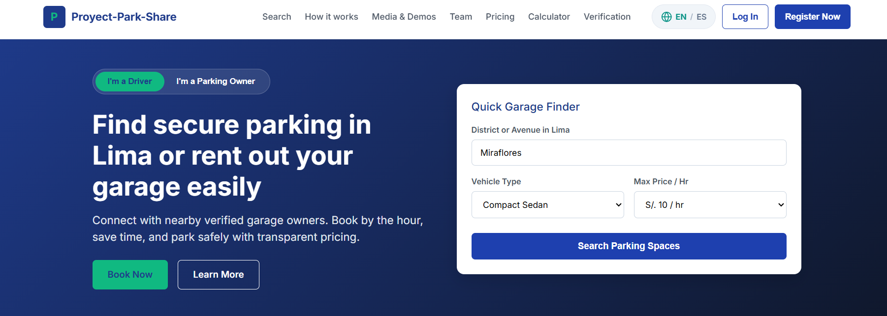

Vista Demo de Cocheras(Demo)

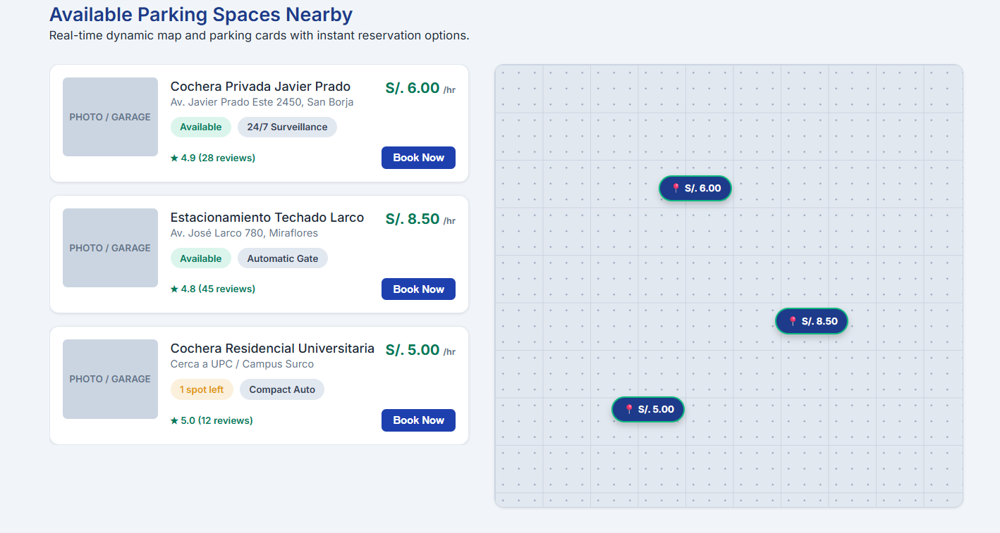

Videos de Demo(Demo)

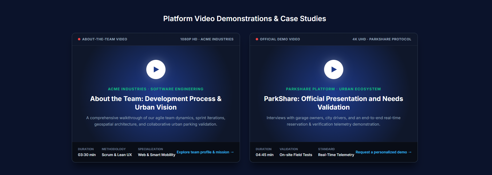

Planes del Producto

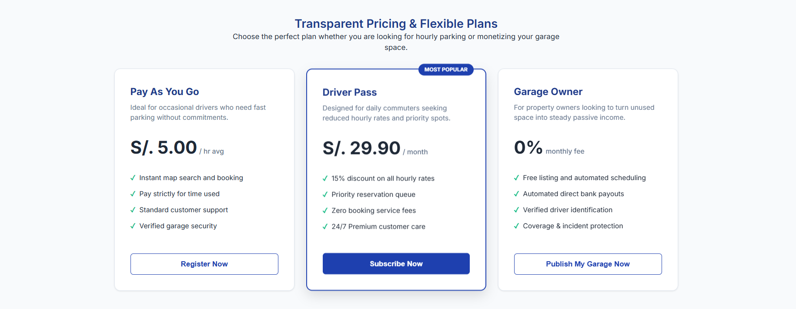

Pasos de Reserva

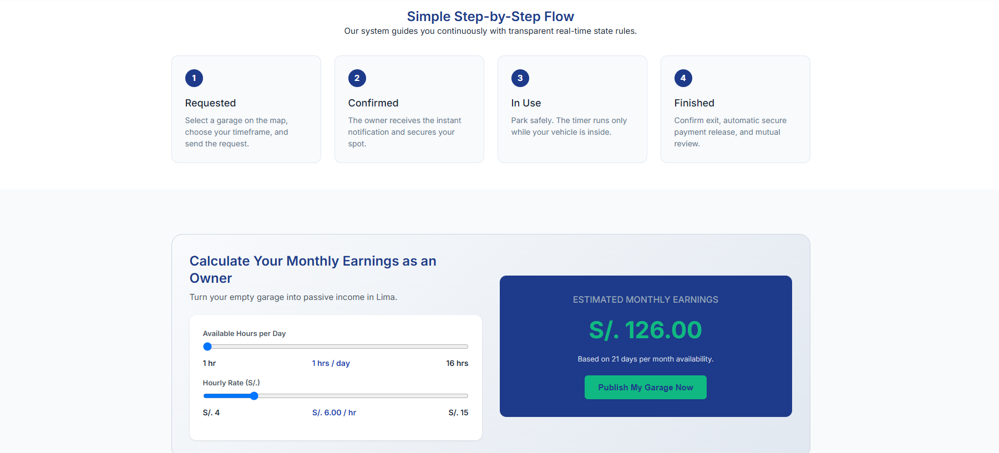

Beneficios

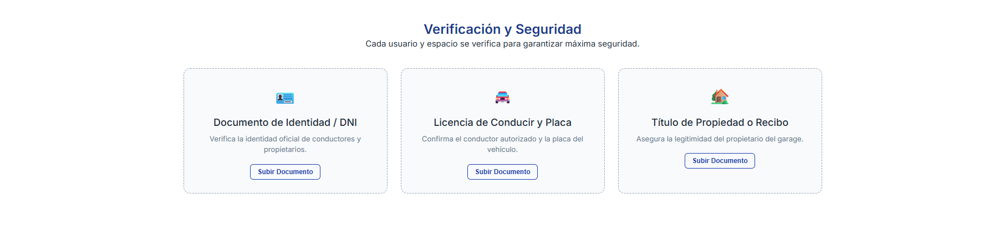

About the Team


Seccion Footer + Questions

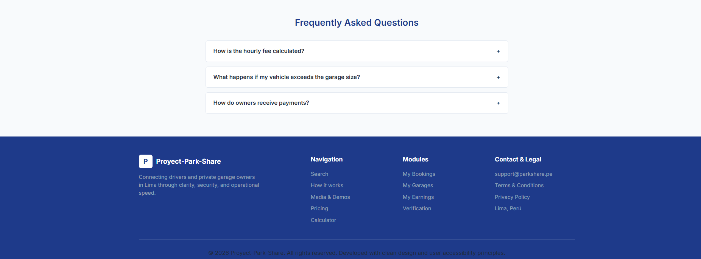

### 5.2.2. Sprint 2

En esta sección se presenta el avance del Sprint 2 en términos de desarrollo del producto y trabajo colaborativo del equipo.

Durante este sprint se implementó la primera versión de la Web Application de ParkShare, desarrollada en Angular con Angular Material, internacionalización (inglés y español) y una arquitectura basada en Domain-Driven Design. El avance se centró en la estructura general de la aplicación (barra lateral de navegación y selector de rol Conductor / Propietario) y en el módulo de perfil del conductor, que incluye el registro de su vehículo y la carga de documentos de verificación.

Asimismo, se incluyen evidencias de la planificación del sprint, la organización del equipo, el desarrollo realizado y los resultados obtenidos.

#### 5.2.2.1. Sprint Planning 2

En esta sección se describen los principales acuerdos y definiciones realizados durante el Sprint Planning del Sprint 2, donde el equipo se enfocó en la implementación de la Web Application para el rol de Conductor.

| Campo                                   | Detalle                                                                                                                                                                                                                                                                                                                                                                                                                                                                                                |
| :-------------------------------------- | :----------------------------------------------------------------------------------------------------------------------------------------------------------------------------------------------------------------------------------------------------------------------------------------------------------------------------------------------------------------------------------------------------------------------------------------------------------------------------------------------------- |
| **Sprint #**                            | Sprint 2                                                                                                                                                                                                                                                                                                                                                                                                                                                                                               |
| **Sprint Planning Background**          |                                                                                                                                                                                                                                                                                                                                                                                                                                                                                                        |
| Date                                    | [COMPLETAR: AAAA-MM-DD]                                                                                                                                                                                                                                                                                                                                                                                                                                                                                |
| Time                                    | [COMPLETAR: HH:MM]                                                                                                                                                                                                                                                                                                                                                                                                                                                                                     |
| Location                                | Reunión virtual (Discord)                                                                                                                                                                                                                                                                                                                                                                                                                                                                              |
| Prepared By                             | [COMPLETAR: nombre del integrante]                                                                                                                                                                                                                                                                                                                                                                                                                                                                     |
| Attendees (to planning meeting)         | Palomino Vilcañaupa, Daril Johan - Tello Palacios, Fabrizio Rafael - Checa Burga, Oscar Diego - Yanac Flores, Gabriel Stefano - Urviola Condori, Mateo Sebastian                                                                                                                                                                                                                                                                                                                                       |
| **Sprint 2 – Review Summary**           | En esta entrega se tomó en cuenta el Sprint 1 (Landing Page), el Product Backlog definido y los prototipos de la Web Application diseñados en el capítulo IV.                                                                                                                                                                                                                                                                                                                                          |
| **Sprint 2 – Retrospective Summary**    | [COMPLETAR: qué funcionó, qué no y qué se mejorará en el siguiente sprint]                                                                                                                                                                                                                                                                                                                                                                                                                             |
| **Sprint Goal & User Stories**          |                                                                                                                                                                                                                                                                                                                                                                                                                                                                                                        |
| **Sprint 2 Goal**                       | Nuestro objetivo es construir la primera versión de la Web Application de ParkShare, con una navegación clara por rol y un perfil de conductor funcional. Consideramos que esto permitirá a los conductores mantener actualizados los datos de su vehículo y gestionar sus documentos de verificación. Confirmaremos el éxito de este objetivo cuando el conductor pueda consultar, editar y guardar la información de su vehículo, y cargar sus documentos, con los datos persistidos en la Fake Api. |
| **User Stories incluidas en el Sprint** | **US04**: Registro de vehículo; **US03**: Verificación de identidad (carga de documentos y estados de revisión).                                                                                                                                                                                                                                                                                                                                                                                       |
| **Sprint 2 Velocity**                   | [COMPLETAR según Trello]                                                                                                                                                                                                                                                                                                                                                                                                                                                                               |
| **Sum of Story Points**                 | 11 Story Points (US04: 3, US03: 8)                                                                                                                                                                                                                                                                                                                                                                                                                                                                     |

#### 5.2.2.2. Aspect Leaders and Collaborators

Para este sprint, los frentes de trabajo se enfocaron en la estructura de la Web Application, el módulo de perfil del conductor y la API simulada que respalda sus datos.

A continuación, se presenta la distribución de roles según las responsabilidades asignadas en el sprint (L: Líder, C: Colaborador, A: Apoyo, X: Sin participación directa)

| Team Member                          | GitHub Username | Layout y navegación | Perfil y vehículo (US04) | Verificación de documentos (US03) | API simulada (json-server) |
| :----------------------------------- | :-------------- | :-----------------: | :----------------------: | :-------------------------------: | :------------------------: |
| **Palomino Vilcañaupa, Daril Johan** | `Daroh19`       |          …          |            …             |                 …                 |             …              |
| **Urviola Condori, Mateo Sebastian** | `BeyaminUv`     |          …          |            …             |                 …                 |             …              |
| **Checa Burga, Oscar Diego**         | `OscarCheca`    |          …          |            …             |                 …                 |             …              |
| **Tello Palacios, Fabrizio Rafael**  | `F4bris`        |          C          |            L             |                 C                 |             C              |
| **Yanac Flores, Gabriel Stefano**    | `u20241d945`    |          …          |            …             |                 …                 |             …              |

#### 5.2.2.3. Sprint Backlog 2

Durante el Sprint 2, la prioridad principal fue el desarrollo de la primera versión de la Web Application de ParkShare para el rol de Conductor, respondiendo a la necesidad de mantener un perfil vigente y confiable dentro de la plataforma.

El seguimiento del Sprint Backlog se administró mediante Trello, con las columnas To-Do, In Progress y Done. Las User Stories se dividieron en las siguientes tareas técnicas:

| User Story  | Tarea técnica                                                                                                      |   Estado    |
| :---------- | :----------------------------------------------------------------------------------------------------------------- | :---------: |
| Transversal | Configuración del proyecto Angular, Angular Material, tema y estructura por bounded contexts (`shared`, `profile`) | [COMPLETAR] |
| Transversal | Layout con barra lateral, selector de rol Conductor / Propietario y rutas por vista                                | [COMPLETAR] |
| Transversal | Internacionalización con ngx-translate (EN / ES) y selector de idioma                                              | [COMPLETAR] |
| US04        | Entidad `Profile`, assembler, endpoint y servicio de infraestructura                                               | [COMPLETAR] |
| US04        | Vista de detalle del perfil con datos del vehículo registrado                                                      | [COMPLETAR] |
| US04        | Formulario de edición del vehículo con validaciones (placa, modelo, tipo)                                          | [COMPLETAR] |
| US03        | Entidad `VerificationDocument`, assembler, endpoint y servicio                                                     | [COMPLETAR] |
| US03        | Lista de documentos con estado (Verificado, En revisión, Rechazado) y carga de archivo                             | [COMPLETAR] |
| Transversal | API simulada con json-server (`db.json`)                                                                           | [COMPLETAR] |

#### 5.2.2.4. Development Evidence for Sprint Review

En este Sprint se logró la implementación de la estructura base de la Web Application de ParkShare y del módulo de perfil del conductor, aplicando una arquitectura por capas (domain, application, infrastructure y presentation) separada en bounded contexts, con estado manejado mediante signals y sin valores fijos en el código (URLs en archivos de entorno y textos en archivos de idioma).

| Repository  | Commit ID     | Commit Message | Commit Message Body | Commit Date |
| :---------- | :------------ | :------------- | :------------------ | :---------- |
| [COMPLETAR] | `[COMPLETAR]` | `[COMPLETAR]`  | [COMPLETAR]         | [COMPLETAR] |

#### 5.2.2.5. Execution Evidence for Sprint Review

En el Sprint 2 se logró implementar la primera versión funcional de la Web Application de ParkShare. A continuación, se presentan las evidencias visuales correspondientes al bounded context **Parking Space Management**, encargado de permitir que los propietarios administren los espacios de estacionamiento que publican dentro de la plataforma.

**Gestión de espacios de estacionamiento del propietario**

La siguiente vista muestra el estado inicial de la sección **Mis cocheras**, antes de que el propietario haya registrado un espacio de estacionamiento. Desde esta pantalla puede iniciar el proceso de publicación mediante la opción correspondiente.

<div align="center">
  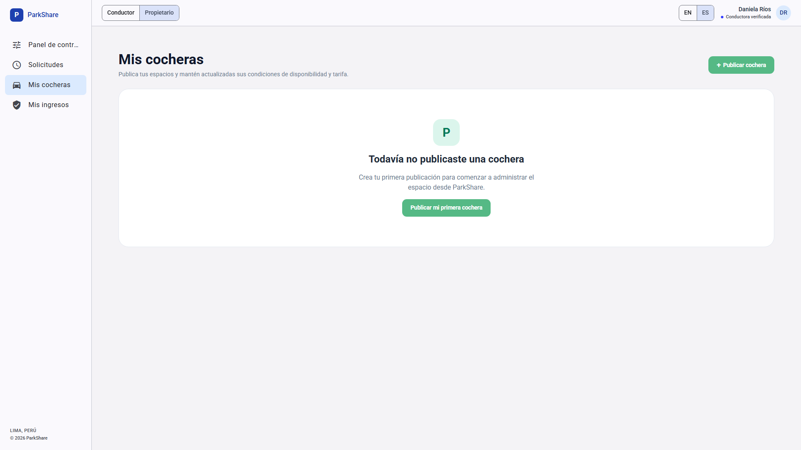
  <p>
    <i><b>Figura:</b> Vista inicial de Mis cocheras sin espacios publicados.</i>
  </p>
</div>

Al seleccionar la opción para publicar una nueva cochera, el sistema presenta un formulario donde el propietario puede ingresar la información requerida para registrar su espacio de estacionamiento, incluyendo los datos necesarios para definir sus características y condiciones de publicación.

<div align="center">
  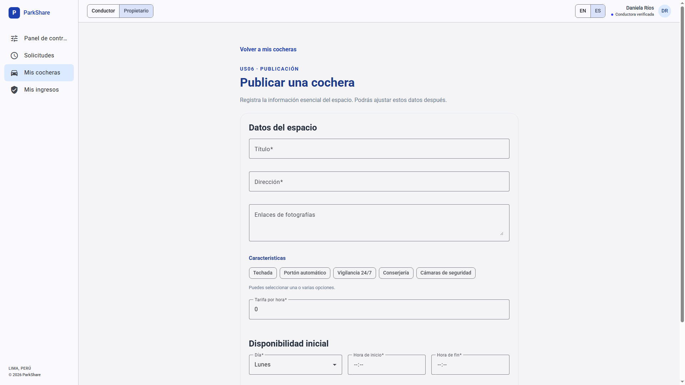
  <p>
    <i><b>Figura:</b> Formulario de publicación de una nueva cochera.</i>
  </p>
</div>

Una vez completado correctamente el formulario y realizada la publicación, el espacio registrado aparece dentro de la sección **Mis cocheras**, permitiendo al propietario visualizar y continuar administrando su publicación.

<div align="center">
  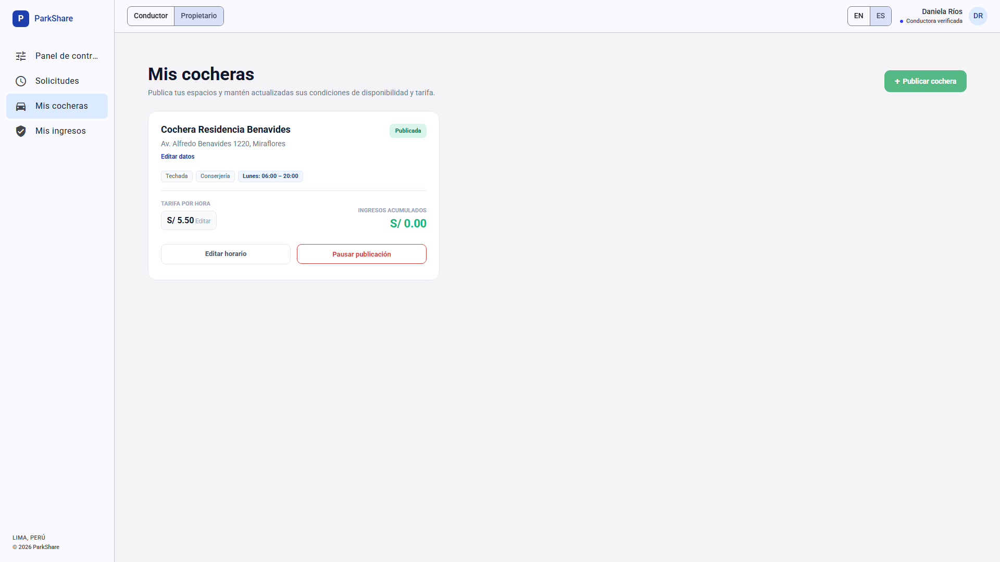
  <p>
    <i><b>Figura:</b> Visualización de una cochera publicada correctamente.</i>
  </p>
</div>

Estas evidencias demuestran el flujo principal de publicación de espacios de estacionamiento implementado en el bounded context **Parking Space Management**, desde el estado inicial sin publicaciones hasta el registro y visualización de una nueva cochera.

#### 5.2.2.6. Services Documentation Evidence for Sprint Review

Durante este sprint, los datos del perfil se consumen desde una API REST simulada con json-server. La URL base y las rutas de cada recurso se definen en los archivos de entorno de la aplicación.

| Recurso    | Método | Ruta                          | Descripción                                                            |
| :--------- | :----- | :---------------------------- | :--------------------------------------------------------------------- |
| Perfil     | GET    | `/profiles`                   | Obtiene los perfiles registrados                                       |
| Perfil     | PUT    | `/profiles/{id}`              | Actualiza los datos del vehículo del perfil                            |
| Documentos | GET    | `/verificationDocuments`      | Obtiene los documentos de verificación                                 |
| Documentos | PUT    | `/verificationDocuments/{id}` | Registra el archivo cargado y pasa el documento a estado "En revisión" |

#### 5.2.2.7. Software Deployment Evidence for Sprint Review

[COMPLETAR: describir como se desplego la Web Application (se despliega en github pages porsiaca) con los pasos realizados: compilación de producción con Angular (`dist/parkshare/browser`), configuración de la rama de publicación y activación del servicio.]

Link de la Web Application: [COMPLETAR]

#### 5.2.2.8. Team Collaboration Insights during Sprint

[COMPLETAR: captura del grafico de contribuciones de GitHub del sprint y breve descripción de la participacion de cada uno.]


### 5.2.3. Sprint 3

En esta sección se presenta el avance del Sprint 3 en términos de desarrollo del producto y trabajo colaborativo del equipo.

Durante este sprint se implementó la primera versión de los Web Services de ParkShare, desarrollados en Spring Boot con Java 21, y se realizó su integración progresiva con la Web Application en Angular, reemplazando la dependencia de la Fake API utilizada en el sprint anterior.
El avance se centró en la exposición y consumo de los servicios RESTful para autenticación y roles, gestión y publicación de cocheras, reservas e historial del conductor, pagos y transferencias, dashboard analítico del propietario, así como el reporte de incidentes con carga de archivos y alertas de emergencia.

Asimismo, se incluyen evidencias de la planificación del sprint, la organización del equipo, el desarrollo realizado, la documentación de la API y los resultados obtenidos.

#### 5.2.3.1. Sprint Planning 3

En esta sección se describen los principales acuerdos y definiciones realizados durante el Sprint Planning del Sprint 3, donde el equipo se enfocó en el desarrollo de la primera versión de los Web Services (Spring Boot / Java 21) y su integración completa con la Web Application en Angular, reemplazando la dependencia de la Fake API utilizada en el sprint anterior[cite: 1].

| Campo                                   | Detalle                                                                                                                                                                                                                                                                                                                                                                                                                                                                                                                                                                                                                                                                                                                                                                                                                                                                              |
| :-------------------------------------- | :----------------------------------------------------------------------------------------------------------------------------------------------------------------------------------------------------------------------------------------------------------------------------------------------------------------------------------------------------------------------------------------------------------------------------------------------------------------------------------------------------------------------------------------------------------------------------------------------------------------------------------------------------------------------------------------------------------------------------------------------------------------------------------------------------------------------------------------------------------------------------------- |
| **Sprint #**                            | Sprint 3                                                                                                                                                                                                                                                                                                                                                                                                                                                                                                                                                                                                                                                                                                                                                                                                                                                                             |
| **Sprint Planning Background**          |                                                                                                                                                                                                                                                                                                                                                                                                                                                                                                                                                                                                                                                                                                                                                                                                                                                                                      |
| Date                                    | 2026-11-13                                                                                                                                                                                                                                                                                                                                                                                                                                                                                                                                                                                                                                                                                                                                                                                                                                                                           |
| Time                                    | 16:30                                                                                                                                                                                                                                                                                                                                                                                                                                                                                                                                                                                                                                                                                                                                                                                                                                                                                |
| Location                                | Reunión virtual (Discord)                                                                                                                                                                                                                                                                                                                                                                                                                                                                                                                                                                                                                                                                                                                                                                                                                                                            |
| Prepared By                             | Palomino Vilcañaupa, Daril Johan                                                                                                                                                                                                                                                                                                                                                                                                                                                                                                                                                                                                                                                                                                                                                                                                                                                     |
| Attendees (to planning meeting)         | Palomino Vilcañaupa, Daril Johan - Tello Palacios, Fabrizio Rafael - Checa Burga, Oscar Diego - Yanac Flores, Gabriel Stefano - Urviola Condori, Mateo Sebastian                                                                                                                                                                                                                                                                                                                                                                                                                                                                                                                                                                                                                                                                                                                     |
| **Sprint 3 – Review Summary**           | En esta entrega se implementó y desplegó la API RESTful de ParkShare en Render (`ParkShare-Platform`), documentada con Swagger/OpenAPI, y se integró con la Web Application (`ParkShare-frontend`) desplegada en GitHub Pages, cubriendo los bounded contexts de IAM, gestión de cocheras, reservas, pagos, analítica del propietario, incidentes y alertas de emergencia.                                                                                                                                                                                                                                                                                                                                                                                                                                                                                                           |
| **Sprint 3 – Retrospective Summary**    | El equipo logró una integración fluida entre backend y frontend gracias a la definición previa de contratos REST y arquitectura por bounded contexts. Como oportunidad de mejora, se identificó la necesidad de estandarizar desde el inicio del sprint los endpoints transversales (como carga de archivos y alertas) para evitar ajustes de última hora en los entornos de despliegue.                                                                                                                                                                                                                                                                                                                                                                                                                                                                                             |
| **Sprint Goal & User Stories**          |                                                                                                                                                                                                                                                                                                                                                                                                                                                                                                                                                                                                                                                                                                                                                                                                                                                                                      |
| **Sprint 3 Goal**                       | Nuestro objetivo es desarrollar e integrar la primera versión funcional de los Web Services de ParkShare con la Web Application en Angular, eliminando la dependencia de datos simulados. Consideramos que esto permitirá ejecutar de extremo a extremo los flujos principales de autenticación, gestión de cocheras, reservas, pagos, analítica e incidentes. Confirmaremos el éxito de este objetivo cuando tanto el backend como el frontend estén desplegados y operando sobre la API REST en producción.                                                                                                                                                                                                                                                                                                                                                                        |
| **User Stories incluidas en el Sprint** | **US01**: Registro de usuario (5 pts); **US02**: Inicio de sesión (3 pts); **US05**: Servicio API de usuarios e identidad (8 pts); **US06**: Publicación de espacio de estacionamiento (5 pts); **US07**: Edición de espacio publicado (3 pts); **US08**: Configuración de disponibilidad (5 pts); **US09**: Configuración de tarifa (3 pts); **US10**: Servicio API de espacios de estacionamiento (8 pts); **US15**: Solicitud de reserva (5 pts); **US16**: Servicio API de búsqueda y reservas (8 pts); **US17**: Confirmación de solicitud de reserva (5 pts); **US18**: Cancelación de reserva (5 pts); **US22**: Pago de reserva (8 pts); **US23**: Consulta de ingresos del propietario (3 pts); **US24**: Calificación después de una reserva (3 pts); **US25**: Recepción de notificaciones (5 pts); **US26**: Servicio API de pagos, reputación y notificaciones (8 pts). |
| **Sprint 3 Velocity**                   | 90 Story Points                                                                                                                                                                                                                                                                                                                                                                                                                                                                                                                                                                                                                                                                                                                                                                                                                                                                      |
| **Sum of Story Points**                 | 90 Story Points                                                                                                                                                                                                                                                                                                                                                                                                                                                                                                                                                                                                                                                                                                                                                                                                                                                                      |

#### 5.2.3.2. Aspect Leaders and Collaborators

Para este tercer sprint, los frentes de trabajo se distribuyeron según los bounded contexts de la plataforma, abarcando tanto la construcción de los servicios REST en `ParkShare-Platform` como su consumo en `ParkShare-frontend`.

A continuación, se presenta la distribución de roles según las responsabilidades asignadas en el sprint
(**L**: Líder, **C**: Colaborador, **A**: Apoyo, **X**: Sin participación directa):

| Team Member (Last Name, First Name)  | GitHub Username | IAM y Seguridad (`US01, US02, US05`) | Espacios y Publicaciones (`US06–US10`) | Reservas e Historial (`US15–US18`) | Pagos, Reputación y Analytics (`US22–US26`) | Incidentes, Alertas y Despliegue |
| :----------------------------------- | :-------------- | :----------------------------------: | :------------------------------------: | :--------------------------------: | :-----------------------------------------: | :------------------------------: |
| **Palomino Vilcañaupa, Daril Johan** | `Daroh19`       |                 [X]                  |                  [A]                   |                [A]                 |                     [A]                     |               [C]                |
| **Urviola Condori, Mateo Sebastian** | `BeyaminUv`     |                 [A]                  |                  [C]                   |                [L]                 |                     [C]                     |               [A]                |
| **Checa Burga, Oscar Diego**         | `OscarCheca`    |                 [L]                  |                  [C]                   |                [A]                 |                     [A]                     |               [C]                |
| **Tello Palacios, Fabrizio Rafael**  | `F4bris`        |                 [C]                  |                  [L]                   |                [L]                 |                     [A]                     |               [L]                |
| **Yanac Flores, Gabriel Stefano**    | `u20241d945`    |                 [A]                  |                  [A]                   |                [C]                 |                     [X]                     |               [C]                |

#### 5.2.3.3. Sprint Backlog 3

Durante el Sprint 3, la prioridad principal fue la construcción de los Web Services en Spring Boot y la migración de los repositorios del frontend Angular hacia la API REST desplegada[cite: 1].

El seguimiento del Sprint Backlog se administró mediante Trello utilizando una codificación jerárquica (`US[Contexto][ID]-TSK3XX`) que vincula cada tarea técnica del sprint con su User Story original en el Product Backlog, organizadas en las columnas _To-Do_, _In Progress_ y _Done_[cite: 1, 6]:

| User Story Base                  | Código Tarea (Trello) | Tarea técnica                                                                                                                                                                      | Estado |
| :------------------------------- | :-------------------- | :--------------------------------------------------------------------------------------------------------------------------------------------------------------------------------- | :----: |
| US01 / US02 / US05               | `USIAM01-TSK301`      | Implementación de endpoints de registro (`POST /users`), autenticación JWT (`POST /tokens`) y roles (`GET /roles`) en Spring Boot.                                                 |  Done  |
| US05                             | `USIAM05-TSK302`      | Implementación de endpoints de perfiles (`/profiles`) y documentos de verificación (`/verification-documents`) e integración HTTP en Angular.                                      |  Done  |
| US06 / US07 / US08 / US09 / US10 | `USPSM10-TSK303`      | Implementación del CRUD de `/parking-spaces` y `/parking-listings` (`PUT`, `PATCH`, filtros por propietario, fotos y periodos de disponibilidad).                                  |  Done  |
| US06 / US07                      | `USPSM06-TSK304`      | Integración del repositorio HTTP de espacios en Angular (`ParkShare-frontend`) conectado a `/parking-listings`.                                                                    |  Done  |
| US15 / US16 / US17 / US18        | `USBKG16-TSK305`      | Implementación de endpoints `/bookings` (`POST`, `GET`, `PUT`) en Spring Boot para gestión de reservas.                                                                            |  Done  |
| US15 / US18                      | `USBKG15-TSK306`      | Desarrollo e integración de la vista de historial de reservas del conductor (`/driver/history`) con resumen y filtros en Angular.                                                  |  Done  |
| US22 / US26                      | `USPAY26-TSK307`      | Implementación de endpoints de transacciones (`/payment-transactions`), resumen de ingresos (`/owner-payouts`) y solicitud de transferencia (`POST /owner-payouts/{id}/transfer`). |  Done  |
| US22                             | `USPAY22-TSK308`      | Integración del flujo de solicitud de transferencia de ingresos del propietario en la Web Application.                                                                             |  Done  |
| US24 / US25 / US26               | `USREP26-TSK309`      | Implementación de servicios REST para calificaciones (`/ratings`), reputación (`/user-reputations/{userId}`) y notificaciones (`/notifications`).                                  |  Done  |
| US23 / US26                      | `USANL23-TSK310`      | Implementación del endpoint `GET /owner-dashboard?ownerId={id}` e integración de indicadores calculados en el dashboard del propietario en Angular.                                |  Done  |
| Transversal                      | `USSAF00-TSK311`      | Implementación del servicio de archivos (`/files`), `FileUploadService` en Angular, reportes de incidentes (`/incidents`) con fotos y alertas de emergencia (`/emergency-alerts`). |  Done  |
| Transversal                      | `USOPS00-TSK312`      | Configuración de `Dockerfile`, carga de datos semilla (`seed`), despliegue del backend en Render y workflow CI/CD del frontend en GitHub Pages.                                    |  Done  |

URL del Trello(Sprint 3): https://trello.com/b/KHiki8SD/product-backlog-3

#### 5.2.3.4. Development Evidence for Sprint Review

Durante el Sprint 3, el equipo concentró el trabajo de implementación principalmente en la evolución de la **Web Application** y en el desarrollo de la primera versión de los **Web Services de ParkShare**.

En el backend se desarrollaron servicios para autenticación y autorización, gestión de espacios y publicaciones, reservas, pagos, analítica para propietarios, almacenamiento de archivos, reportes de incidentes y alertas de emergencia. Asimismo, se incorporaron configuraciones para persistencia, seguridad y despliegue de la aplicación.

En la Web Application se integraron los servicios REST desarrollados con Spring Boot, reemplazando progresivamente la dependencia de la Fake API utilizada en etapas anteriores. También se implementaron funcionalidades relacionadas con reservas, historial del conductor, gestión de espacios, pagos, reportes de incidentes, alertas de emergencia y el dashboard del propietario.

Los principales repositorios involucrados durante este Sprint fueron:

- **Web Services:** `1ASI0729-7793-ParkShare/ParkShare-Platform`
- **Web Application:** `1ASI0729-7793-ParkShare/ParkShare-frontend`

A continuación se presentan commits representativos de los principales avances realizados durante el Sprint 3.

| Repository           | Branch    | Commit Id | Commit Message                                                                            | Commit Message Body                                                                         | Committed on |
| -------------------- | --------- | --------- | ----------------------------------------------------------------------------------------- | ------------------------------------------------------------------------------------------- | ------------ |
| `ParkShare-Platform` | `develop` | `158193c` | `feat(iam): add sign-up, sign-in, users and roles endpoints`                              | —                                                                                           | 2026-11-14   |
| `ParkShare-Platform` | `develop` | `cb9b260` | `feat(shared): add local file storage service and files endpoint`                         | —                                                                                           | 2026-11-14   |
| `ParkShare-Platform` | `develop` | `e6e04c6` | `feat(booking): extend parking listing with features, photos and availability periods`    | —                                                                                           | 2026-11-14   |
| `ParkShare-Platform` | `develop` | `0ff3dce` | `feat(booking): add owner filter and partial PATCH for parking listings`                  | —                                                                                           | 2026-11-14   |
| `ParkShare-Platform` | `develop` | `e671a67` | `feat(incidents): accept multiple incident types and photo lists`                         | —                                                                                           | 2026-11-14   |
| `ParkShare-Platform` | `develop` | `d011dd6` | `feat(emergency-alerts): update alert resources and controller contract`                  | —                                                                                           | 2026-11-14   |
| `ParkShare-Platform` | `develop` | `735ab8f` | `feat(payments): add payouts, transfer and transactions endpoints`                        | —                                                                                           | 2026-11-14   |
| `ParkShare-Platform` | `develop` | `bd8138e` | `feat(report-analytics): add owner dashboard endpoint`                                    | —                                                                                           | 2026-11-14   |
| `ParkShare-Platform` | `develop` | `59d6f27` | `feat(seed): add demo data seeder with listings, reservations, ratings and profiles`      | —                                                                                           | 2026-11-14   |
| `ParkShare-Platform` | `develop` | `03b5e8b` | `chore(docker): add Dockerfile and .dockerignore for Render deployment`                   | —                                                                                           | 2026-11-14   |
| `ParkShare-Platform` | `main`    | `caa623e` | `Merge branch 'release/1.0.0' into main`                                                  | —                                                                                           | 2026-11-14   |
| `ParkShare-frontend` | `develop` | `0b0dab6` | `feat(emergency-alerts): add domain model for emergency alerts`                           | —                                                                                           | 2026-11-12   |
| `ParkShare-frontend` | `develop` | `0734507` | `feat(incident-reporting): add presentation for incident reporting`                       | —                                                                                           | 2026-11-12   |
| `ParkShare-frontend` | `develop` | `d91f78f` | `config: point environments to the Spring Boot backend and add files and dashboard paths` | —                                                                                           | 2026-11-14   |
| `ParkShare-frontend` | `develop` | `e70a867` | `feat(shared): add FileUploadService to upload photos to the backend`                     | —                                                                                           | 2026-11-14   |
| `ParkShare-frontend` | `develop` | `21a7a6c` | `feat(incidents): upload incident photos before creating the report`                      | —                                                                                           | 2026-11-14   |
| `ParkShare-frontend` | `develop` | `de32ea3` | `feat(parking-spaces): add HTTP repository backed by /parking-listings`                   | —                                                                                           | 2026-11-14   |
| `ParkShare-frontend` | `develop` | `5754387` | `fix(payments): request payout transfer through POST /owner-payouts/{id}/transfer`        | —                                                                                           | 2026-11-14   |
| `ParkShare-frontend` | `develop` | `804a704` | `feat(report-analytics): consume server-calculated owner dashboard`                       | —                                                                                           | 2026-11-14   |
| `ParkShare-frontend` | `develop` | `99c68e3` | `feat(booking): add driver history view with summary and filters`                         | —                                                                                           | 2026-11-14   |
| `ParkShare-frontend` | `develop` | `8dd0525` | `feat(booking): route /driver/history to the history view`                                | —                                                                                           | 2026-11-14   |
| `ParkShare-frontend` | `develop` | `c1b34fd` | `ci: add GitHub Pages deployment workflow`                                                | —                                                                                           | 2026-11-14   |
| `ParkShare-frontend` | `main`    | `7767e7a` | `Merge branch 'release/2.0.0' into main`                                                  | Merge de la versión `2.0.0` e integración de los cambios del Sprint 3 en la rama principal. | 2026-11-14   |
| `ParkShare-frontend` | `main`    | `1be384d` | `fix(env): point development environment to the deployed backend`                         | —                                                                                           | 2026-11-14   |

##### Web Services Development

El desarrollo del repositorio `ParkShare-Platform` permitió construir la primera versión completa del backend de ParkShare siguiendo una organización modular y basada en los bounded contexts definidos previamente.

Entre los principales avances se encuentran:

- implementación de registro, autenticación y generación de JWT;
- persistencia mediante Spring Data JPA;
- gestión de espacios de estacionamiento;
- publicación y actualización de parking listings;
- gestión de reservas;
- almacenamiento y recuperación de imágenes;
- gestión de pagos y transferencias para propietarios;
- calificaciones y reputación;
- reportes de incidentes;
- alertas de emergencia;
- cálculo de indicadores para el dashboard del propietario;
- incorporación de datos de demostración;
- configuración para despliegue mediante Docker y Render.

Al finalizar este incremento, la primera versión del backend fue consolidada mediante la integración de `release/1.0.0` en la rama `main`.

##### Web Application Development

En el repositorio `ParkShare-frontend` se desarrollaron e integraron las funcionalidades necesarias para consumir los Web Services implementados durante el Sprint.

Uno de los principales cambios fue la sustitución progresiva de las fuentes de datos simuladas por repositorios HTTP conectados con la API REST de ParkShare.

La configuración del frontend fue actualizada para utilizar como URL base:

```text id="d00hhk"
https://parkshare-platform.onrender.com/api/v1
```

Entre los principales avances se encuentran:

- integración del módulo de espacios con los Web Services;
- integración del dashboard del propietario con los cálculos realizados por el backend;
- integración del sistema de pagos y transferencias;
- carga de fotografías mediante el servicio de archivos;
- implementación de reportes de incidentes;
- implementación de alertas de emergencia;
- incorporación del historial de reservas del conductor;
- actualización de rutas y navegación;
- configuración de los environments para consumir el backend desplegado.

Finalmente, los cambios desarrollados durante el Sprint fueron consolidados mediante la rama `release/2.0.0` e integrados posteriormente en `main`.

Como resultado, el Sprint 3 permitió avanzar desde una Web Application respaldada principalmente por datos simulados hacia una solución integrada con una **API REST desplegada**, estableciendo comunicación entre el frontend Angular y los Web Services desarrollados con Spring Boot.

#### 5.2.3.5. Execution Evidence for Sprint Review

Durante el Sprint 3 se amplió la Web Application de ParkShare mediante la incorporación e integración de funcionalidades dirigidas tanto a conductores como a propietarios de espacios de estacionamiento.

En este incremento se logró integrar la aplicación Angular con los Web Services desarrollados mediante Spring Boot, permitiendo ejecutar operaciones relacionadas con el dashboard del propietario, administración de espacios de estacionamiento, historial de reservas, consulta de ingresos y reporte de incidentes.

Las siguientes evidencias corresponden a la ejecución de la versión desarrollada durante el Sprint 3.

##### Owner Dashboard

Para el segmento de propietarios se implementó un dashboard que centraliza los principales indicadores relacionados con la actividad de sus espacios de estacionamiento.

Esta vista permite consultar indicadores como ingresos mensuales, reservas pendientes, reservas en curso, porcentaje de ocupación, calificación promedio e ingresos correspondientes a la semana. También incluye información relacionada con la actividad reciente del propietario.

La información presentada es obtenida mediante los Web Services de ParkShare, principalmente a través del endpoint:

```text
GET /api/v1/owner-dashboard?ownerId={id}
```

La ruta correspondiente dentro de la Web Application es:

```text
/owner/dashboard
```

<div align="center">
  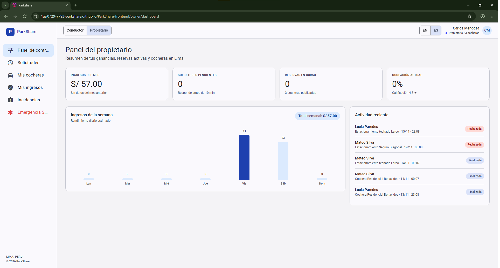
  <p>
    <i><b>Figura X.</b> Dashboard del propietario mostrando los principales indicadores relacionados con sus espacios de estacionamiento. Fuente: elaboración propia.</i>
  </p>
</div>

Esta funcionalidad permite que el propietario pueda obtener una visión general del desempeño de sus publicaciones desde una única interfaz.

##### Parking Space Management

La Web Application incorpora un módulo destinado a la administración de los espacios de estacionamiento pertenecientes al propietario.

La vista principal permite consultar los espacios registrados y acceder a diferentes operaciones relacionadas con su gestión, como publicación, edición, disponibilidad y configuración de precios.

La ruta utilizada para esta funcionalidad es:

```text
/owner/parking-spaces
```

<div align="center">
  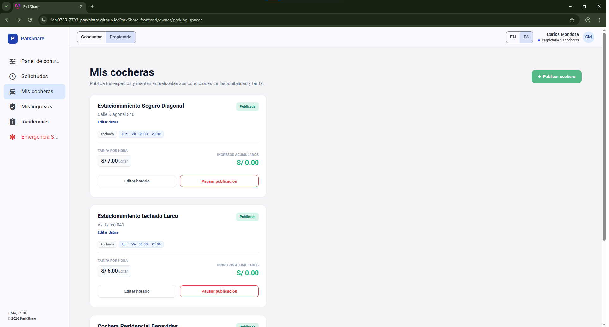
  <p>
    <i><b>Figura X.</b> Vista de administración de los espacios de estacionamiento registrados por el propietario. Fuente: elaboración propia.</i>
  </p>
</div>

La información mostrada en esta sección es recuperada desde los Web Services mediante los repositorios HTTP implementados en la Web Application.

##### Parking Space Publication

Como parte del módulo de administración de espacios, se implementó también el formulario para registrar y publicar nuevas cocheras dentro de ParkShare.

La ruta correspondiente es:

```text
/owner/parking-spaces/new
```

Desde esta interfaz el propietario puede ingresar información como:

- nombre del espacio;
- dirección;
- características disponibles;
- tarifa por hora;
- fotografías;
- día de disponibilidad;
- hora de inicio;
- hora de finalización.

<div align="center">
  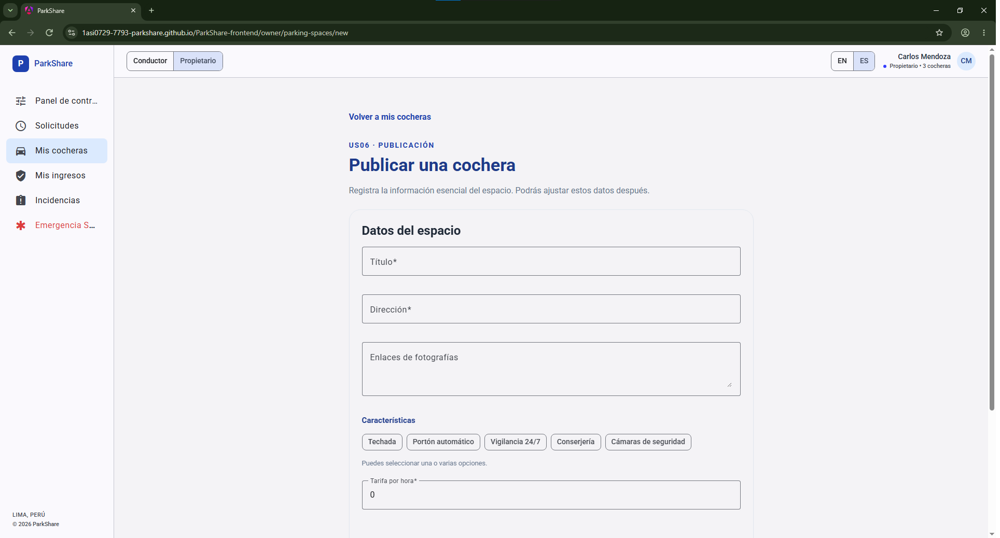
  <p>
    <i><b>Figura X.</b> Formulario utilizado por el propietario para registrar y publicar un nuevo espacio de estacionamiento. Fuente: elaboración propia.</i>
  </p>
</div>

Los datos ingresados pueden ser enviados posteriormente hacia los Web Services encargados de administrar los espacios y publicaciones disponibles dentro de ParkShare.

##### Driver Reservation History

Para el segmento de conductores se incorporó una vista destinada a consultar el historial de reservas realizadas mediante la plataforma.

La ruta correspondiente es:

```text
/driver/history
```

La interfaz presenta un resumen de la actividad del conductor, incluyendo información como reservas completadas, cantidad de horas utilizadas y monto acumulado gastado.

También se incorporaron filtros que permiten organizar las reservas según su estado.

<div align="center">
  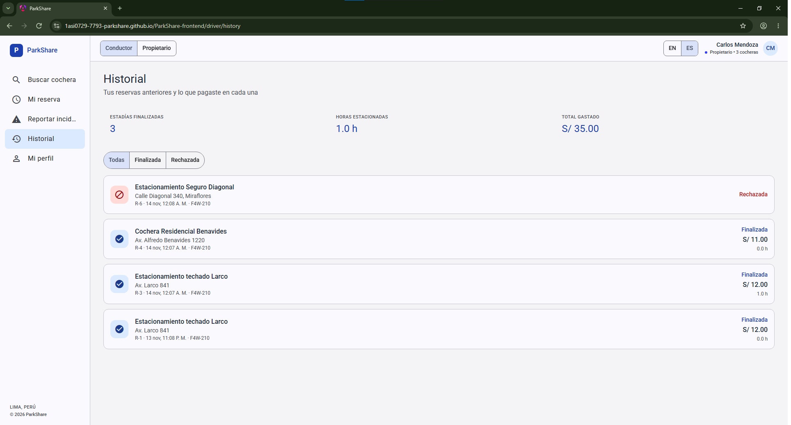
  <p>
    <i><b>Figura X.</b> Historial de reservas del conductor mostrando información resumida y filtros según el estado de las reservas. Fuente: elaboración propia.</i>
  </p>
</div>

Esta funcionalidad proporciona al conductor un registro centralizado de las reservas realizadas previamente mediante ParkShare.

##### Owner Earnings and Payouts

Durante el Sprint 3 también se integró la funcionalidad destinada a la visualización de ingresos del propietario.

La sección se encuentra disponible mediante la ruta:

```text
/owner/earnings/owner-payouts
```

Desde esta interfaz el propietario puede consultar su balance, revisar las transacciones asociadas a sus espacios de estacionamiento y solicitar la transferencia del saldo disponible.

<div align="center">
  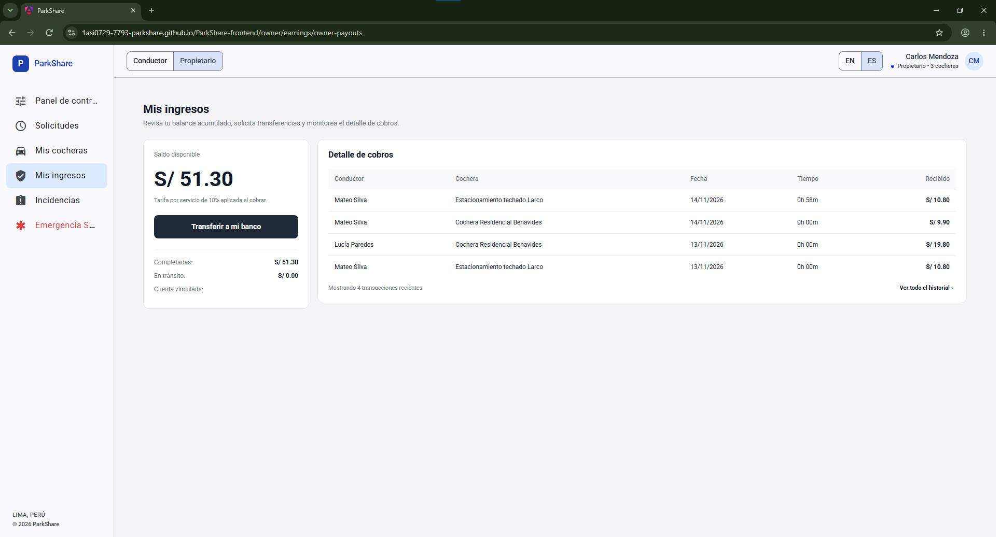
  <p>
    <i><b>Figura X.</b> Vista de ingresos, balance y transacciones correspondientes al propietario. Fuente: elaboración propia.</i>
  </p>
</div>

La funcionalidad se encuentra integrada con los siguientes servicios:

```text
GET /api/v1/owner-payouts?ownerId={id}

GET /api/v1/payment-transactions?ownerId={id}

POST /api/v1/owner-payouts/{id}/transfer
```

De esta manera, la información financiera presentada en la interfaz es obtenida desde los Web Services de ParkShare.

##### Incident Reporting

Se incorporó también una funcionalidad para que los conductores puedan registrar incidentes relacionados con los espacios de estacionamiento utilizados.

La ruta correspondiente es:

```text
/driver/incidents
```

Desde esta interfaz el usuario puede registrar información relacionada con un incidente y consultar los reportes realizados previamente.

<div align="center">
  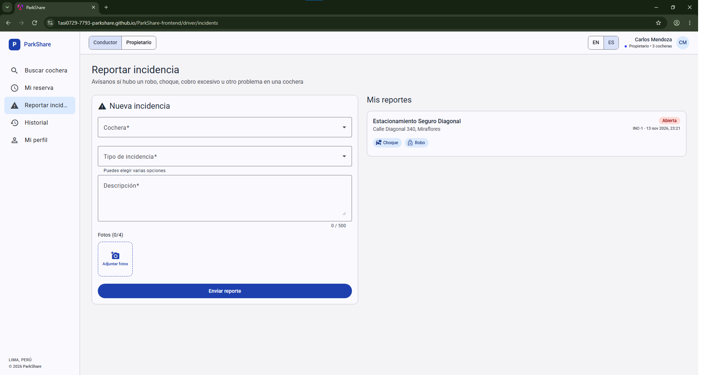
  <p>
    <i><b>Figura X.</b> Vista destinada al registro y consulta de incidentes por parte del conductor. Fuente: elaboración propia.</i>
  </p>
</div>

La funcionalidad también contempla la posibilidad de asociar fotografías al reporte, las cuales pueden ser procesadas mediante el servicio de almacenamiento de archivos implementado en el backend.

##### Execution Summary

Las evidencias presentadas permiten comprobar la ejecución de las principales funcionalidades desarrolladas e integradas durante el Sprint 3.

Entre los principales resultados alcanzados se encuentran:

- visualización del dashboard e indicadores del propietario;
- administración de espacios de estacionamiento;
- registro y publicación de nuevas cocheras;
- consulta del historial de reservas del conductor;
- consulta de ingresos y transacciones del propietario;
- registro y seguimiento de incidentes;
- integración de la Web Application Angular con los Web Services de ParkShare.

El Sprint 3 permitió avanzar desde una aplicación respaldada principalmente por información simulada hacia una solución integrada, en la cual diferentes funcionalidades del frontend consumen los servicios REST proporcionados por `ParkShare-Platform`.

##### Video de ejecución

Como complemento a las evidencias presentadas, se incluye un video de ejecución en el que se muestran las principales funcionalidades desarrolladas durante el Sprint 3 y la navegación entre las diferentes secciones de la Web Application.

**URL del video:** `[]`

#### 5.2.3.6. Services Documentation Evidence for Sprint Review

Durante el Sprint 3 se implementó y documentó la primera versión de los **Web Services de ParkShare**, desarrollados con **Spring Boot 3.5.7 y Java 21**. La solución expone una API RESTful encargada de brindar soporte a las principales funcionalidades de la plataforma, incluyendo autenticación, perfiles, gestión de espacios de estacionamiento, reservas, pagos, reputación, notificaciones y analítica para propietarios.

Para la documentación de los servicios se utilizó **OpenAPI Specification mediante Springdoc OpenAPI**, permitiendo visualizar y probar los endpoints disponibles directamente desde Swagger UI. Cada operación documentada incluye el método HTTP utilizado, la ruta del recurso, parámetros de entrada, estructura de las solicitudes y posibles respuestas del servidor.

La documentación desplegada se encuentra disponible en:

[ParkShare Platform API - Swagger UI](https://parkshare-platform.onrender.com/swagger-ui/index.html)

Asimismo, el código fuente de los Web Services se encuentra disponible en:

[ParkShare Platform - GitHub Repository](https://github.com/1ASI0729-7793-ParkShare/ParkShare-Platform)

La URL base utilizada por la Web Application para consumir los servicios es:

```text
https://parkshare-platform.onrender.com/api/v1
```

##### Documentación general de los Web Services

Swagger UI organiza los endpoints de ParkShare según los diferentes recursos y responsabilidades de la plataforma. Entre los servicios documentados se encuentran autenticación de usuarios, perfiles, espacios de estacionamiento, publicaciones, reservas, pagos, calificaciones, notificaciones, reportes de incidentes y analítica para propietarios.

<div align="center">
  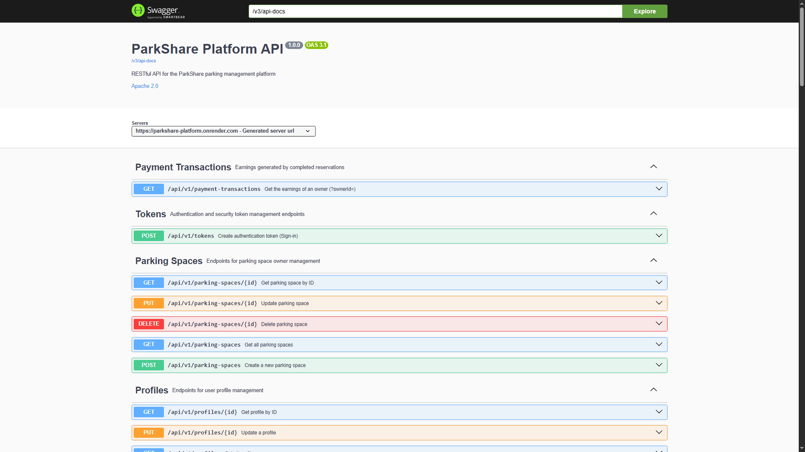
  <p>
    <i><b>Figura X.</b> Vista general de la documentación de ParkShare Platform API mediante Swagger UI. Fuente: elaboración propia.</i>
  </p>
</div>

La API desplegada corresponde a la versión **1.0.0 de ParkShare Platform API** y utiliza OpenAPI 3.1 para describir las operaciones disponibles.

##### Principales endpoints implementados

A continuación se presentan los principales recursos expuestos por los Web Services durante el Sprint 3.

| Recurso                | Método   | Endpoint                                    | Descripción                                                     |
| ---------------------- | -------- | ------------------------------------------- | --------------------------------------------------------------- |
| Users                  | `POST`   | `/api/v1/users`                             | Registra un nuevo usuario.                                      |
| Users                  | `GET`    | `/api/v1/users`                             | Obtiene los usuarios registrados.                               |
| Users                  | `GET`    | `/api/v1/users/{userId}`                    | Obtiene un usuario por identificador.                           |
| Tokens                 | `POST`   | `/api/v1/tokens`                            | Autentica un usuario y genera un token JWT.                     |
| Roles                  | `GET`    | `/api/v1/roles`                             | Obtiene los roles disponibles.                                  |
| Profiles               | `POST`   | `/api/v1/profiles`                          | Registra un perfil de usuario.                                  |
| Profiles               | `GET`    | `/api/v1/profiles`                          | Obtiene los perfiles registrados.                               |
| Profiles               | `GET`    | `/api/v1/profiles/{id}`                     | Obtiene un perfil por identificador.                            |
| Profiles               | `PUT`    | `/api/v1/profiles/{id}`                     | Actualiza los datos de un perfil.                               |
| Verification Documents | `POST`   | `/api/v1/verification-documents`            | Registra un documento de verificación.                          |
| Verification Documents | `GET`    | `/api/v1/verification-documents`            | Obtiene los documentos registrados.                             |
| Parking Spaces         | `POST`   | `/api/v1/parking-spaces`                    | Registra un nuevo espacio de estacionamiento.                   |
| Parking Spaces         | `GET`    | `/api/v1/parking-spaces`                    | Obtiene los espacios registrados.                               |
| Parking Spaces         | `GET`    | `/api/v1/parking-spaces/{id}`               | Obtiene un espacio por identificador.                           |
| Parking Spaces         | `PUT`    | `/api/v1/parking-spaces/{id}`               | Actualiza un espacio de estacionamiento.                        |
| Parking Spaces         | `DELETE` | `/api/v1/parking-spaces/{id}`               | Elimina un espacio de estacionamiento.                          |
| Parking Listings       | `POST`   | `/api/v1/parking-listings`                  | Publica un espacio dentro del marketplace.                      |
| Parking Listings       | `GET`    | `/api/v1/parking-listings`                  | Obtiene las publicaciones disponibles.                          |
| Parking Listings       | `GET`    | `/api/v1/parking-listings/{id}`             | Obtiene los detalles de una publicación.                        |
| Parking Listings       | `PUT`    | `/api/v1/parking-listings/{id}`             | Actualiza una publicación.                                      |
| Parking Listings       | `PATCH`  | `/api/v1/parking-listings/{id}`             | Actualiza parcialmente una publicación.                         |
| Bookings               | `POST`   | `/api/v1/bookings`                          | Registra una nueva reserva.                                     |
| Bookings               | `GET`    | `/api/v1/bookings`                          | Obtiene las reservas existentes.                                |
| Bookings               | `GET`    | `/api/v1/bookings/{id}`                     | Obtiene una reserva específica.                                 |
| Bookings               | `PUT`    | `/api/v1/bookings/{id}`                     | Actualiza el estado de una reserva.                             |
| Payment Transactions   | `GET`    | `/api/v1/payment-transactions?ownerId={id}` | Consulta las transacciones de un propietario.                   |
| Owner Payouts          | `GET`    | `/api/v1/owner-payouts?ownerId={id}`        | Consulta el resumen de ingresos del propietario.                |
| Owner Payouts          | `POST`   | `/api/v1/owner-payouts/{id}/transfer`       | Solicita una transferencia del saldo disponible.                |
| Ratings                | `POST`   | `/api/v1/ratings`                           | Registra una calificación.                                      |
| Ratings                | `GET`    | `/api/v1/ratings`                           | Obtiene las calificaciones registradas.                         |
| User Reputations       | `GET`    | `/api/v1/user-reputations/{userId}`         | Obtiene la reputación de un usuario.                            |
| Notifications          | `POST`   | `/api/v1/notifications`                     | Registra una notificación.                                      |
| Notifications          | `GET`    | `/api/v1/notifications`                     | Obtiene las notificaciones existentes.                          |
| Owner Dashboard        | `GET`    | `/api/v1/owner-dashboard?ownerId={id}`      | Obtiene los indicadores del dashboard de un propietario.        |
| Incidents              | `POST`   | `/api/v1/incidents`                         | Registra un incidente.                                          |
| Incidents              | `GET`    | `/api/v1/incidents`                         | Obtiene los incidentes registrados.                             |
| Emergency Alerts       | `POST`   | `/api/v1/emergency-alerts`                  | Registra una alerta de emergencia.                              |
| Emergency Alerts       | `GET`    | `/api/v1/emergency-alerts`                  | Obtiene las alertas registradas.                                |
| Files                  | `POST`   | `/api/v1/files`                             | Permite cargar imágenes relacionadas con espacios o incidentes. |
| Files                  | `GET`    | `/api/v1/files/{fileName}`                  | Recupera una imagen almacenada.                                 |

##### Evidencia de creación de un espacio de estacionamiento

Para comprobar el funcionamiento de las operaciones de escritura se utilizó el endpoint:

```http
POST /api/v1/parking-spaces
```

Este servicio permite registrar un nuevo espacio perteneciente a un propietario. Durante la prueba se utilizó un recurso con información de dirección, nombre, tarifa por hora, características y periodos de disponibilidad.

Ejemplo del request utilizado:

```json
{
  "ownerId": 1,
  "address": "Av. Javier Prado 1234",
  "name": "Cochera Javier Prado",
  "hourlyRate": 8.5,
  "features": "Techada, portón automático",
  "availabilityPeriods": [
    {
      "dayOfWeek": "MONDAY",
      "startTime": "09:00",
      "endTime": "18:00"
    }
  ]
}
```

La solicitud fue procesada satisfactoriamente por el servidor, obteniendo el código:

```text
201 Created
```

junto con la representación del espacio registrado.

<div align="center">
  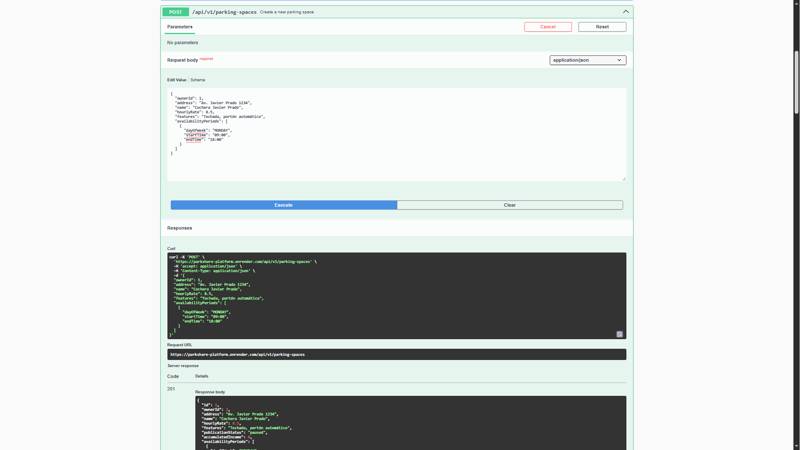
  <p>
    <i><b>Figura X.</b> Ejecución del endpoint POST /api/v1/parking-spaces mediante Swagger UI, registrando un nuevo espacio de estacionamiento y obteniendo una respuesta HTTP 201. Fuente: elaboración propia.</i>
  </p>
</div>

Esta evidencia permite comprobar que los Web Services desplegados son capaces de recibir información desde un cliente, validar los datos proporcionados y persistir correctamente un nuevo recurso.

##### Evidencia de consulta de espacios de estacionamiento

Posteriormente se realizó una operación de lectura con el objetivo de verificar que el recurso previamente registrado pudiera ser recuperado desde el backend.

Para ello se utilizó:

```http
GET /api/v1/parking-spaces
```

mediante la URL:

```text
https://parkshare-platform.onrender.com/api/v1/parking-spaces
```

El servidor respondió satisfactoriamente mediante:

```text
200 OK
```

retornando una colección JSON que contiene el espacio registrado anteriormente.

<div align="center">
  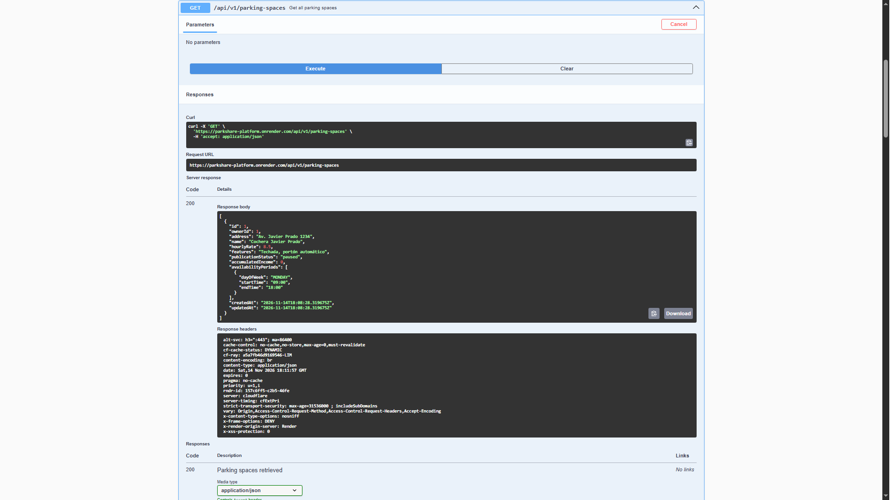
  <p>
    <i><b>Figura X.</b> Ejecución del endpoint GET /api/v1/parking-spaces mediante Swagger UI, obteniendo una respuesta HTTP 200 con el espacio de estacionamiento previamente registrado. Fuente: elaboración propia.</i>
  </p>
</div>

La respuesta contiene información como:

```json
{
  "id": 1,
  "ownerId": 1,
  "address": "Av. Javier Prado 1234",
  "name": "Cochera Javier Prado",
  "hourlyRate": 8.5,
  "features": "Techada, portón automático",
  "publicationStatus": "paused",
  "availabilityPeriods": [
    {
      "dayOfWeek": "MONDAY",
      "startTime": "09:00",
      "endTime": "18:00"
    }
  ]
}
```

La ejecución consecutiva de las operaciones `POST` y `GET` permite evidenciar el funcionamiento del ciclo de creación y recuperación de los espacios administrados por ParkShare.

##### Evidencia del servicio de Report & Analytics

Durante el Sprint 3 también se implementó un servicio destinado a proporcionar los indicadores utilizados en el dashboard de los propietarios.

La consulta se realiza mediante:

```http
GET /api/v1/owner-dashboard?ownerId={id}
```

El parámetro `ownerId` corresponde al identificador del propietario cuyos indicadores se desean consultar.

Durante la prueba se utilizó:

```text
ownerId = 1
```

generándose la solicitud:

```text
https://parkshare-platform.onrender.com/api/v1/owner-dashboard?ownerId=1
```

El servidor respondió satisfactoriamente con:

```text
200 OK
```

La respuesta contiene indicadores calculados por el backend relacionados con la actividad del propietario, entre ellos:

- ingresos mensuales;
- variación de ingresos;
- reservas pendientes;
- reservas en curso;
- cantidad de publicaciones;
- porcentaje de ocupación;
- calificación promedio;
- ingresos correspondientes a la semana;
- actividad reciente.

<div align="center">
  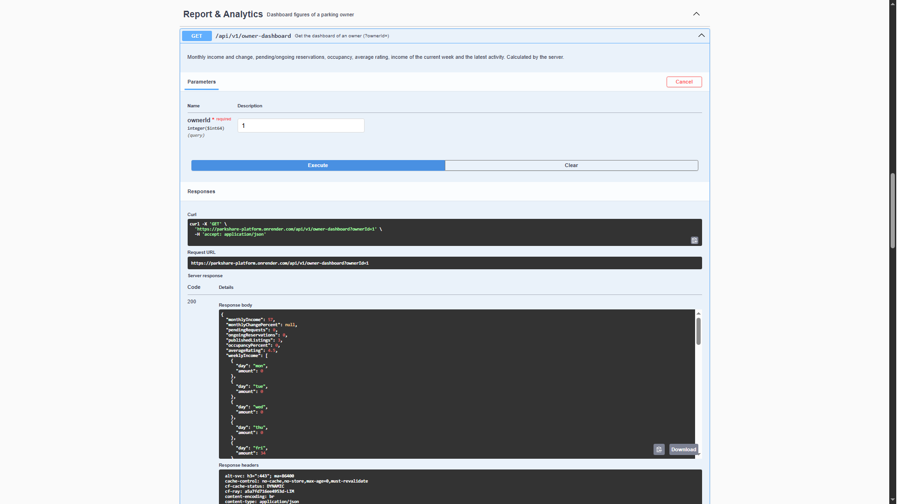
  <p>
    <i><b>Figura X.</b> Ejecución del endpoint GET /api/v1/owner-dashboard mediante Swagger UI para consultar los indicadores correspondientes al propietario con identificador 1, obteniendo una respuesta HTTP 200. Fuente: elaboración propia.</i>
  </p>
</div>

Esta operación permite que los indicadores requeridos por la interfaz del propietario sean calculados por los Web Services y posteriormente consumidos por la Web Application de ParkShare.

##### Evidencias de implementación

El código correspondiente a los Web Services se encuentra centralizado en el repositorio **ParkShare-Platform**. Entre los commits relacionados con la implementación y preparación de esta primera versión se encuentran:

| Commit ID | Commit Message                                                                       | Descripción                                                                                             |
| --------- | ------------------------------------------------------------------------------------ | ------------------------------------------------------------------------------------------------------- |
| `bd8138e` | `feat(report-analytics): add owner dashboard endpoint`                               | Implementación del servicio que proporciona los indicadores utilizados en el dashboard del propietario. |
| `59d6f27` | `feat(seed): add demo data seeder with listings, reservations, ratings and profiles` | Incorporación de datos de demostración correspondientes a los principales recursos de la plataforma.    |
| `03b5e8b` | `chore(docker): add Dockerfile and .dockerignore for Render deployment`              | Incorporación de la configuración necesaria para desplegar los Web Services mediante Render.            |
| `caa623e` | `Merge branch 'release/1.0.0' into main`                                             | Integración de la primera versión estable de ParkShare Platform en la rama principal.                   |

Como resultado del Sprint 3, ParkShare cuenta con una primera versión funcional y desplegada de sus Web Services, documentada mediante OpenAPI/Swagger y accesible desde la Web Application para soportar las principales operaciones de la plataforma.

#### 5.2.3.7. Software Deployment Evidence for Sprint Review

Durante el Sprint 3 se realizaron las actividades necesarias para desplegar e integrar los principales productos digitales de ParkShare: **Landing Page, Web Application y RESTful Web Services**.

Uno de los principales avances de este Sprint fue la publicación de la primera versión de los Web Services desarrollados con Spring Boot, así como la configuración de la Web Application Angular para consumir dichos servicios desde un entorno de producción. Adicionalmente, se configuró un proceso automatizado de construcción y despliegue del frontend utilizando GitHub Actions y GitHub Pages.

La configuración de deployment utilizada durante el Sprint se resume a continuación:

| Producto        | Tecnología             | Plataforma de Deployment       | Estado     |
| --------------- | ---------------------- | ------------------------------ | ---------- |
| Landing Page    | HTML, CSS y JavaScript | GitHub Pages                   | Desplegado |
| Web Application | Angular                | GitHub Pages + GitHub Actions  | Desplegado |
| Web Services    | Spring Boot / Java 21  | Render                         | Desplegado |
| Persistencia    | PostgreSQL             | Integrada con los Web Services | Operativa  |

##### Landing Page Deployment

El Landing Page de ParkShare se encuentra desplegado mediante **GitHub Pages**, permitiendo el acceso público a la propuesta de valor y principales características de la solución.

Repositorio:

[landing-page-ParkShare](https://github.com/1ASI0729-7793-ParkShare/landing-page-ParkShare)

Aplicación desplegada:

[ParkShare Landing Page](https://1asi0729-7793-parkshare.github.io/landing-page-ParkShare/)

El flujo general de publicación puede representarse de la siguiente manera:

```text
Landing Page Repository
        ↓
      GitHub
        ↓
   GitHub Pages
        ↓
 Public Landing Page
```

<div align="center">
  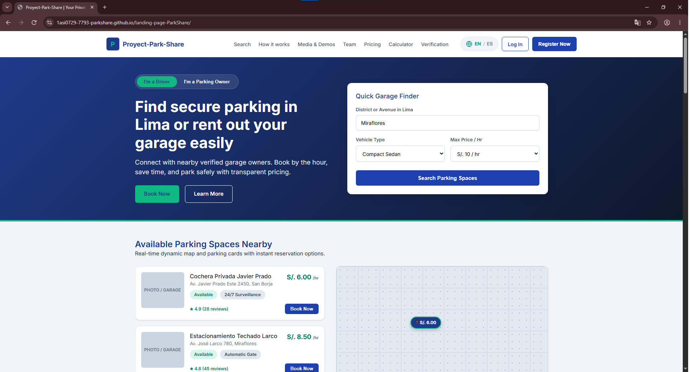
  <p>
    <i><b>Figura X.</b> Landing Page de ParkShare ejecutándose desde su deployment público mediante GitHub Pages. Fuente: elaboración propia.</i>
  </p>
</div>

La evidencia permite comprobar que el Landing Page puede ser accedido públicamente mediante HTTPS desde el dominio proporcionado por GitHub Pages.

##### Web Services Deployment

Durante el Sprint 3 se desplegó la primera versión de los **RESTful Web Services de ParkShare**, desarrollados utilizando **Spring Boot 3.5.7 y Java 21**.

El código fuente se encuentra disponible en:

[ParkShare-Platform](https://github.com/1ASI0729-7793-ParkShare/ParkShare-Platform)

Para facilitar el proceso de deployment se incorporó un `Dockerfile` utilizando una estrategia de construcción en múltiples etapas.

En la primera etapa se utiliza Maven para compilar la aplicación:

```dockerfile
FROM maven:3.9-eclipse-temurin-21 AS build
WORKDIR /app

COPY pom.xml .
RUN mvn -B -q dependency:go-offline

COPY src ./src
RUN mvn -B -q clean package -DskipTests
```

Posteriormente, el archivo JAR generado es ejecutado mediante una imagen con Java 21:

```dockerfile
FROM eclipse-temurin:21-jre
WORKDIR /app

COPY --from=build /app/target/*.jar app.jar

ENV JAVA_TOOL_OPTIONS="-Xmx400m"

EXPOSE 8080

ENTRYPOINT ["java", "-jar", "app.jar"]
```

Esta configuración fue incorporada mediante el commit:

```text
03b5e8b
chore(docker): add Dockerfile and .dockerignore for Render deployment
```

La configuración de producción permite utilizar PostgreSQL mediante variables de entorno:

```properties
spring.datasource.url=jdbc:postgresql://${DATABASE_URL}:${DATABASE_PORT:5432}/${DATABASE_NAME}?sslmode=require
spring.datasource.username=${DATABASE_USER}
spring.datasource.password=${DATABASE_PASSWORD}
```

De esta forma, información sensible como credenciales de base de datos o secretos JWT no necesita almacenarse directamente dentro del código fuente.

El flujo de deployment del backend puede representarse de la siguiente manera:

```text
ParkShare-Platform
       ↓
GitHub Repository
       ↓
   Dockerfile
       ↓
   Maven Build
       ↓
Spring Boot JAR
       ↓
     Render
       ↓
   PostgreSQL
```

Los Web Services se encuentran desplegados mediante Render en:

```text
https://parkshare-platform.onrender.com
```

La URL base utilizada para los servicios REST es:

```text
https://parkshare-platform.onrender.com/api/v1
```

Asimismo, la documentación OpenAPI desplegada puede consultarse mediante:

[ParkShare Platform API - Swagger UI](https://parkshare-platform.onrender.com/swagger-ui/index.html)

<div align="center">
  
  <p>
    <i><b>Figura X.</b> ParkShare Platform API desplegada mediante Render y accesible públicamente a través de Swagger UI. Fuente: elaboración propia.</i>
  </p>
</div>

Esta evidencia permite comprobar que los Web Services desplegados pueden ser accedidos desde Internet y utilizados por la Web Application mediante solicitudes HTTP sobre HTTPS.

##### Web Application Deployment

La Web Application de ParkShare fue desarrollada utilizando **Angular** y se encuentra desplegada mediante **GitHub Pages**.

Repositorio:

[ParkShare-frontend](https://github.com/1ASI0729-7793-ParkShare/ParkShare-frontend)

Aplicación desplegada:

[ParkShare Web Application](https://1asi0729-7793-parkshare.github.io/ParkShare-frontend/)

Durante el Sprint 3 se incorporó un workflow de **GitHub Actions** encargado de automatizar la construcción y publicación de la aplicación.

El workflow se encuentra definido en:

```text
.github/workflows/deploy.yml
```

y se ejecuta al producirse cambios sobre la rama `main`.

El proceso configurado puede representarse como:

```text
Push / Merge a main
        ↓
   GitHub Actions
        ↓
      npm ci
        ↓
 Angular Production Build
        ↓
GitHub Pages Artifact
        ↓
 actions/deploy-pages
        ↓
   GitHub Pages
```

Para generar el build de producción se utiliza:

```bash
npx ng build --configuration production --base-href /ParkShare-frontend/
```

Adicionalmente, debido al uso del sistema de routing de Angular, se genera un archivo `404.html` a partir del archivo principal:

```bash
cp dist/parkshare/browser/index.html dist/parkshare/browser/404.html
```

Posteriormente, el resultado generado es publicado utilizando:

```text
actions/deploy-pages@v4
```

Durante el Sprint se verificó la ejecución satisfactoria del proceso de deployment mediante GitHub Actions, obteniéndose correctamente el despliegue de la aplicación en el environment `github-pages`.

<div align="center">
  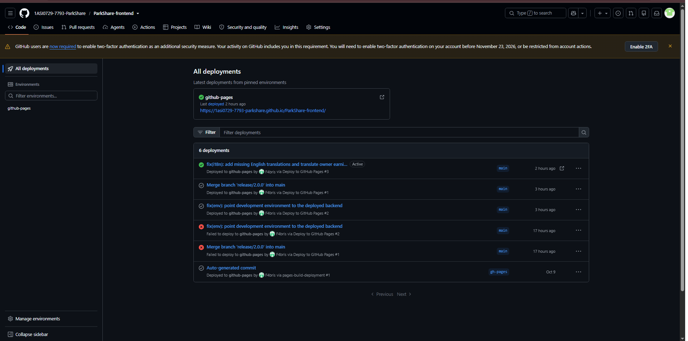
  <p>
    <i><b>Figura X.</b> Evidencia del deployment satisfactorio de ParkShare Web Application en el environment github-pages mediante GitHub Actions. Fuente: elaboración propia.</i>
  </p>
</div>

La aplicación resultante puede ser accedida públicamente mediante GitHub Pages.

<div align="center">
  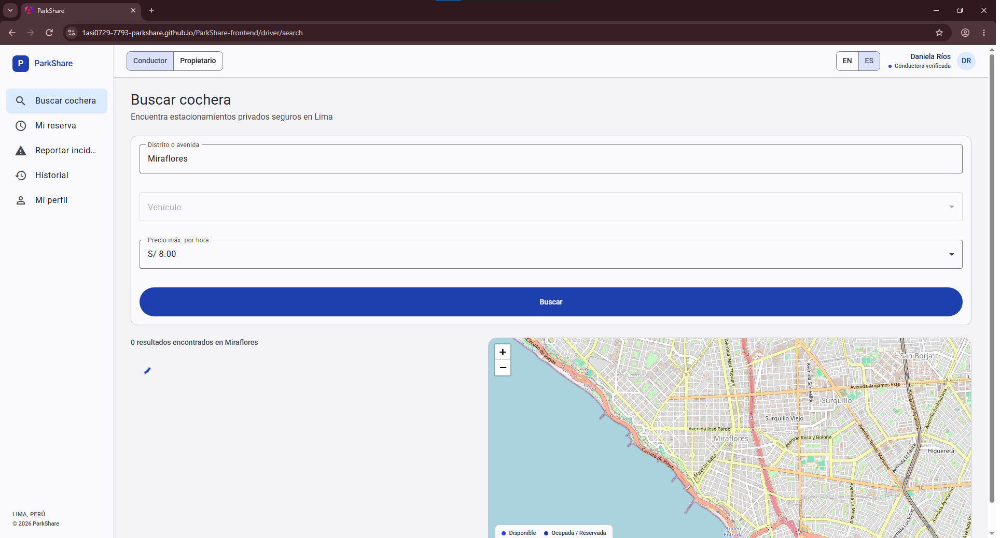
  <p>
    <i><b>Figura X.</b> Web Application de ParkShare ejecutándose desde su deployment público en GitHub Pages. Fuente: elaboración propia.</i>
  </p>
</div>

La evidencia muestra además una de las funcionalidades disponibles para el segmento de conductores, correspondiente a la búsqueda de espacios de estacionamiento.

##### Integración entre Web Application y Web Services

Como parte del Sprint 3 se modificó la configuración del frontend para consumir directamente los Web Services desplegados mediante Render.

La URL configurada en los environments de Angular corresponde a:

```typescript
platformProviderApiBaseUrl: "https://parkshare-platform.onrender.com/api/v1";
```

A partir de esta URL, la Web Application puede consumir servicios relacionados con perfiles, reservas, publicaciones de estacionamientos, pagos, reputación, incidentes, archivos y analítica.

La arquitectura desplegada puede representarse de la siguiente manera:

```text
                         ParkShare
                            │
              ┌─────────────┴─────────────┐
              │                           │
       Landing Page                Web Application
       GitHub Pages                GitHub Pages
                                          │
                                          │ HTTPS
                                          ▼
                               ParkShare Platform API
                                        Render
                                          │
                                          ▼
                                      PostgreSQL
```

De esta manera, el frontend actúa como cliente de los servicios REST proporcionados por `ParkShare-Platform`, mientras que el backend concentra la lógica de negocio, persistencia y procesamiento de información.

##### Deployment Summary

Como resultado del Sprint 3, ParkShare dispone de una arquitectura desplegada e integrada que permite acceder públicamente a sus principales productos digitales.

Se logró mantener disponible el Landing Page mediante GitHub Pages, desplegar la Web Application Angular mediante un proceso automatizado de GitHub Actions, desplegar la primera versión de los Web Services mediante Render e integrar el frontend con dichos servicios.

Asimismo, se incorporó PostgreSQL para la persistencia de información y se utilizaron variables de entorno para la configuración de parámetros y credenciales sensibles.

Con estas actividades se obtuvo una primera versión integrada y desplegada de ParkShare, permitiendo utilizar la Web Application desde Internet y consumir los servicios REST proporcionados por el backend.

#### 5.2.3.8. Team Collaboration Insights during Sprint

Durante el Sprint 3, el trabajo colaborativo del equipo se organizó mediante el flujo de ramas basado en GitFlow y convenciones de Conventional Commits en los repositorios oficiales `ParkShare-Platform` (backend) y `ParkShare-frontend` (aplicación web), coordinando los avances a través de reuniones sincrónicas en Discord y tableros ágiles en Trello

La división por bounded contexts permitió desarrollar en paralelo los servicios RESTful y su respectiva integración en el frontend sin generar conflictos críticos durante la consolidación en `develop`. A continuación, se presentan las métricas de contribuciones registradas en GitHub durante este periodo:

Frotend:

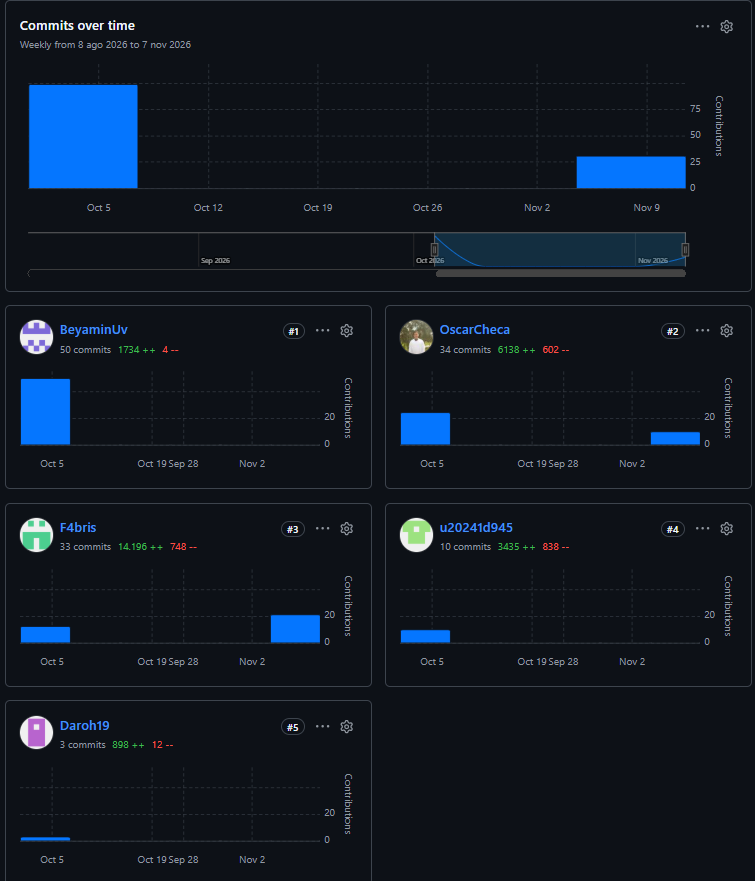

Backend:

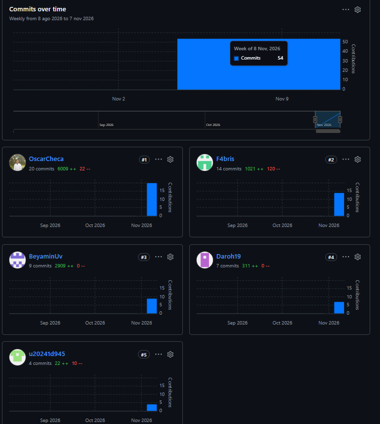

## 5.3. Validation Interviews

### 5.3.1. Diseño de Entrevistas

Las entrevistas de validación de ParkShare tienen como objetivo conocer la opinión de los usuarios pertenecientes a los segmentos objetivo respecto al Landing Page y a las principales funcionalidades propuestas en la Web Application.

A diferencia de las entrevistas realizadas durante la etapa de Needfinding, en esta etapa los participantes podrán observar directamente la solución desarrollada. Durante cada sesión, el entrevistador realizará un recorrido por las principales secciones de ParkShare, explicando brevemente las opciones disponibles y mostrando los flujos relacionados con el segmento al que pertenece el participante.

Posteriormente, el entrevistado podrá explorar la interfaz y responder una serie de preguntas orientadas a evaluar la claridad de la información, facilidad de uso, organización de las opciones, percepción de seguridad y utilidad de las funcionalidades presentadas.

Para la validación se consideran los dos segmentos objetivo definidos para ParkShare:

- **Segmento 1: Conductores en Zonas Urbanas.**
- **Segmento 2: Propietarios de Espacios y Negocios.**

#### Segmento 1: Conductores en Zonas Urbanas

Para los participantes pertenecientes al segmento de conductores se presentará inicialmente el Landing Page de ParkShare, explicando su propuesta de valor y las principales secciones disponibles.

Posteriormente se mostrarán las principales funcionalidades de la Web Application relacionadas con un conductor.

Después de mostrar la solución, se realizarán las siguientes preguntas:

1. Luego de revisar ParkShare, ¿te queda claro cuál es el objetivo de la plataforma?

2. ¿Qué opinas de la forma en la que está organizada la página?

3. ¿Te resultaría fácil encontrar una cochera disponible utilizando esta plataforma?

4. ¿La información mostrada sobre cada cochera te parece suficiente para decidir si utilizarla?

5. ¿Qué información consideras más importante antes de reservar un estacionamiento?

6. ¿El proceso de reserva te parece fácil de comprender?

7. ¿Te resulta clara la sección donde puedes consultar tus reservas?

8. ¿Te parece sencillo encontrar y modificar la información de tu perfil y vehículo?

9. ¿Qué opinas de las opciones de verificación de identidad?

10. ¿Hay alguna sección, botón u opción que te haya resultado confusa?

11. ¿Hay alguna información que consideres que falta en la plataforma?

12. ¿Qué funcionalidad presentada te parece más útil?

13. ¿Qué cambiarías o mejorarías de la aplicación?

14. En una escala del 1 al 5, ¿qué tan fácil consideras que sería utilizar ParkShare?

15. ¿Utilizarías ParkShare si necesitaras encontrar estacionamiento? ¿Por qué?

#### Segmento 2: Propietarios de Espacios y Negocios

Para los participantes pertenecientes al segmento de propietarios se realizará inicialmente un recorrido por el Landing Page, mostrando cómo ParkShare presenta la posibilidad de aprovechar espacios de estacionamiento disponibles para generar ingresos.

Posteriormente se mostrarán las principales opciones de la Web Application relacionadas con la administración de espacios de estacionamiento.

Después del recorrido se realizarán las siguientes preguntas:

1. Luego de revisar ParkShare, ¿te queda claro qué beneficios ofrece la plataforma a un propietario?

2. ¿Qué opinas de la organización de las opciones para administrar una cochera?

3. ¿Te parece fácil identificar dónde publicar un nuevo espacio?

4. ¿Los datos solicitados para registrar una cochera te parecen adecuados?

5. ¿Te parece claro cómo establecer el precio del estacionamiento?

6. ¿Te resulta comprensible cómo indicar los horarios o periodos en los que la cochera estará disponible?

7. ¿Te parece sencillo modificar posteriormente los datos de una cochera?

8. ¿La información mostrada sobre las cocheras publicadas te parece suficiente?

9. ¿La sección de ingresos resulta fácil de comprender?

10. ¿Qué información te gustaría conocer sobre los conductores antes de aceptar una reserva?

11. ¿Las medidas de seguridad y verificación mostradas te generarían confianza para ofrecer tu espacio?

12. ¿Hay alguna opción o sección que te haya resultado confusa?

13. ¿Qué funcionalidad presentada te parece más útil como propietario?

14. ¿Qué elemento añadirías o mejorarías?

15. En una escala del 1 al 5, ¿qué tan fácil consideras que sería administrar una cochera mediante ParkShare?

16. ¿Utilizarías ParkShare para ofrecer un espacio de estacionamiento disponible? ¿Por qué?

### 5.3.2. Registro de Entrevistas

#### Entrevista de Validación 1 — Segmento 1: Conductores en Zonas Urbanas

**Datos del entrevistado**

- **Nombres y apellidos:** Richard Palomino 
- **Edad:** 20 años
- **Distrito:** SJL
- **Segmento:** Conductores en Zonas Urbanas
- **Inicio de la entrevista:** 00:00
- **Duración aproximada:** 9 minutos 16 segundos
- **URL del video:** https://youtu.be/ZxhUMCFCTQE?si=ejNBluJLtlklTBX5 

<div align="center">
  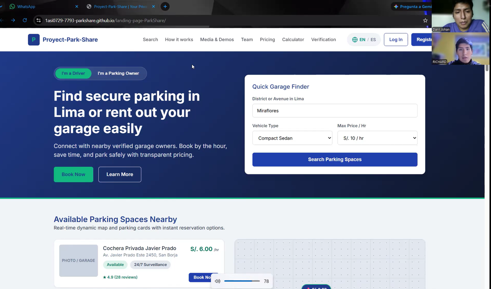
  <p>
    <i><b>Figura X.</b> Entrevista de validación realizada a Richard Palomino, participante del segmento Conductores en Zonas Urbanas</i>
  </p>
</div>

##### Resumen de la entrevista

Durante la sesión con el segmento de conductores, se presentó  el Landing Page de ParkShare, explicando el funcionamiento del proyecto y su calculadora de tarifas. Posteriormente, el entrevistado —Richard Palomino, de 20 años y residente en San Juan de Lurigancho— interactuó con la plataforma revisando el proceso de búsqueda, registro de vehículo y reserva de espacios.

El participante manifestó comprender rápidamente la propuesta de valor de ParkShare y consideró que la navegación resulta ordenada e intuitiva, destacando la búsqueda y reserva en tiempo real mediante mapa o lista como su función más útil.

Respecto a la información de las cocheras, consideró adecuados los datos básicos mostrados (ubicación, precio, horarios y fotos), aunque sugirió detallar el tamaño del espacio (para camionetas), si es techado, las medidas de seguridad (cámaras, vigilancia, rejas) y las valoraciones de otros usuarios.

En cuanto al proceso de reserva y gestión de cuenta, encontró los pasos claros y valoró poder registrar los datos de su vehículo. No obstante, recomendó mostrar un resumen del costo total antes de pagar, separar las reservas por estado (activas, próximas y pasadas), explicar mejor la verificación de identidad y las políticas de cancelación, y añadir secciones de soporte, métodos de pago y preguntas frecuentes.

Como principales oportunidades de mejora, propuso incorporar filtros avanzados (por precio, horario y distancia), un sistema de reseñas, notificaciones de recordatorio, navegación hacia la cochera y la opción de guardar espacios favoritos.

Finalmente, calificó la facilidad de uso con **4.5 de 5** y afirmó que utilizaría ParkShare en zonas congestionadas como Miraflores o San Isidro para ahorrar tiempo, siempre que cuente con buenas reseñas y precios competitivos.

#### Entrevista de Validación 2 — Segmento 1: Conductores en Zonas Urbanas

**Datos del entrevistado**

- **Nombres y apellidos:** Wilson Zapata
- **Edad:** 46 años
- **Distrito:** Breña
- **Segmento:** Conductores en Zonas Urbanas
- **Inicio de la entrevista:** 00:00
- **Duración aproximada:** 24 minutos 52 segundos
- **URL del video:** https://youtu.be/fpRhEHXe7mE

<div align="center">
  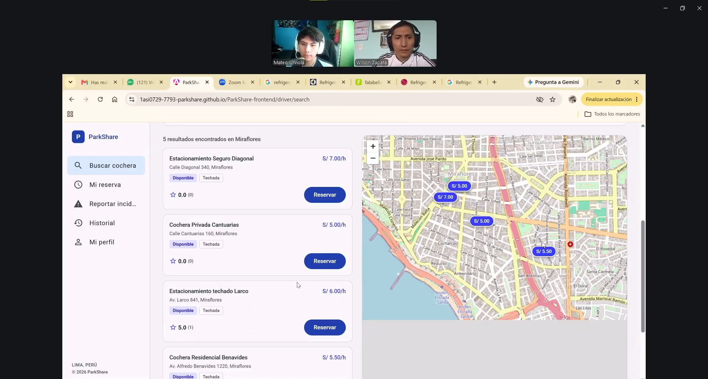
  <p>
    <i><b>Figura X.</b> Entrevista de validación realizada a Wilson Zapata, participante del segmento Conductores en Zonas Urbanas</i>
  </p>
</div>

##### Resumen de la entrevista

Durante la sesión con el segmento de conductores, se presentó  el Landing Page de ParkShare, explicando el funcionamiento del proyecto y su calculadora de tarifas. Posteriormente, el entrevistado —Wilson Zapata, de 46 años y residente en Breña— interactuó con la plataforma revisando el proceso de búsqueda, registro de vehículo y reserva de espacios.

El participante realizo la observación en ajustar la lista de opciones para seleccionar en tipo de vehículo, ya que no se encuentra la opción de camioneta. Además, sugirió que se pueda visualizar el tamaño del espacio de estacionamiento para poder reservarlo según el tipo de vehículo. Además en la seccion de registrar o actualizar su vehiculo de su perfil recomienda establecer un formato en el campo de la placa de vehiculo con el guion fijado y un límite de caracteres para una placa de vehiculo de acuerdo a las normas del MTC, y que las mayusculas al introducir la placa del vehiculo se encuentren en mayúsculas. Además, en el campo de modelos de vehiculo deberia haber una tabla estándar para los modelos de vehiculos. También recomendó que se pueda visualizar la cantidad de cocheras disponibles en el mapa sin necesidad de reservarlas, para poder elegir la mejor opción según su ubicación y precio. Además que en el mapa digital se muestren los precios diferenciados de las cocheras con un juego de colores para poder diferenciar los precios más económicos de los más caros.

En cuanto al proceso de reserva y gestión de cuenta, encontró los pasos claros y valoró poder registrar los datos de su vehículo. No obstante, recomendó mostrar un resumen del costo total antes de pagar, separar las reservas por estado (activas, próximas y pasadas), explicar mejor la verificación de identidad y las políticas de cancelación, y añadir secciones de soporte, métodos de pago y preguntas frecuentes.

Finalmente, calificó la facilidad de uso con **4 de 5** y afirmó que utilizaría y recomendaria ParkShare diariamente porque frecuentemente usa este tipo de servicios si levantamos las observaciones clave como mostrar en el mapa la cantidad de cocheras disponibles sin reservar en una posicion del mapa.

---
#### Entrevista de Validación 1 — Segmento 2: Propietarios de Espacios y Negocios

**Datos del entrevistado**

- **Nombres y apellidos:** Daniel Pinedo Gonzalez
- **Edad:** 21 años
- **Distrito:** Ventanilla
- **Segmento:** Propietarios de Espacios y Negocios
- **Inicio de la entrevista:** 00:00
- **Duración aproximada:** 8 minutos 30 segundos
- **URL del video:** https://www.youtube.com/watch?v=lqYY3AHs86Y

<div align="center">
  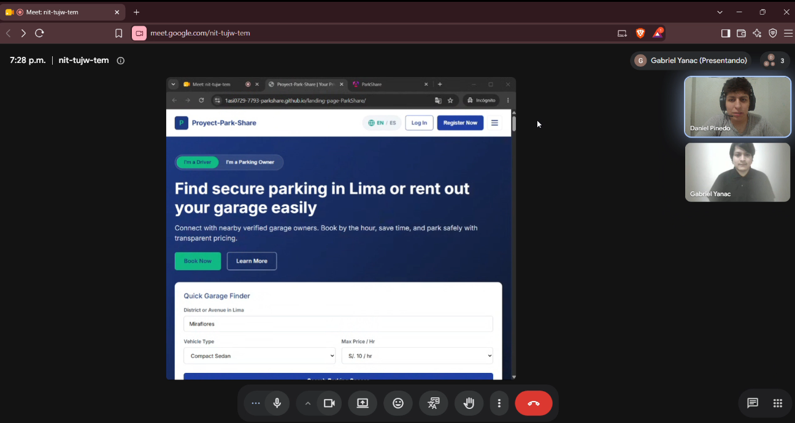
  <p>
    <i><b>Figura X.</b> Entrevista de validación realizada a Daniel Pinedo Gonzalez, participante del segmento Propietarios de Espacios y Negocios.</i>
  </p>
</div>

##### Resumen de la entrevista

Durante la sesión se presentó inicialmente el Landing Page de ParkShare, explicando la propuesta de valor de la plataforma para conductores y propietarios. Posteriormente se realizó un recorrido por la Web Application desde la perspectiva del propietario, mostrando el dashboard, la administración de cocheras, el formulario para publicar un nuevo espacio y la sección destinada a ingresos y transferencias.

El entrevistado manifestó comprender con facilidad la propuesta de ParkShare y consideró útil la posibilidad de publicar espacios disponibles para generar ingresos adicionales. Asimismo, indicó que la organización de las opciones dentro de la plataforma resulta ordenada y que las principales funcionalidades pueden identificarse con relativa facilidad después de un breve recorrido.

Respecto al proceso de publicación de una cochera, consideró adecuados los datos solicitados, especialmente la dirección, tarifa, características, horarios y fotografías. También señaló que la configuración de la tarifa y de los periodos de disponibilidad resulta sencilla de comprender.

En relación con la administración de los espacios publicados, el participante consideró que la información disponible es suficiente, aunque sugirió mostrar de manera más visible la cantidad de reservas realizadas en cada cochera.

La sección de ingresos también fue percibida positivamente debido a la separación entre balance y transacciones, así como a la posibilidad de solicitar transferencias desde la misma plataforma.

En cuanto a seguridad, el entrevistado manifestó que sería importante conocer información del conductor como su nombre, estado de verificación, calificación y datos básicos del vehículo. Asimismo, señaló que los mecanismos de verificación tanto para conductores como para propietarios incrementarían su confianza al momento de ofrecer un espacio.

Como principal oportunidad de mejora, propuso incorporar estadísticas más detalladas para cada cochera, como los horarios con mayor cantidad de reservas y los ingresos generados individualmente por cada espacio.

Finalmente, calificó la facilidad de administración de una cochera con **4 de 5** y afirmó que utilizaría ParkShare para ofrecer un espacio disponible, especialmente como una alternativa para aprovechar una cochera que permanece vacía durante determinadas horas y generar ingresos adicionales.


**Escala utilizada (criterio de evaluación):**
- 1 = Cumplimiento muy bajo (requiere rediseño)
- 2 = Cumplimiento bajo (requiere correcciones mayores)
- 3 = Cumplimiento aceptable (requiere mejoras)
- 4 = Cumplimiento bueno (ajustes menores)
- 5 = Cumplimiento completo (sin observaciones críticas)

| Heurística  | Hallazgo principal                                  | Evidencia observada | Puntaje (1-5) |
| :--- |:----------------------------------------------------| :--- | :---: |
|  Relación sistema–mundo real | Terminología alineada al negocio de cocheras         | Entrevistados comprenden módulos sin capacitación previa | 5 |
|  Consistencia y estándares | Coherencia visual entre landing y web app           | Design system uniforme en colores, tipografía y navegación | 5 |
|  Flexibilidad y eficiencia | Dashboard accesible desde navegador sin instalación | Acceso desde Chrome en desktop y móvil| 4 |
|  Diseño estético y minimalista | Interfaz limpia orientada a datos operativos        | Entrevistados no reportan sobrecarga visual | 5 | 


## 5.4. Video About-the-Product


